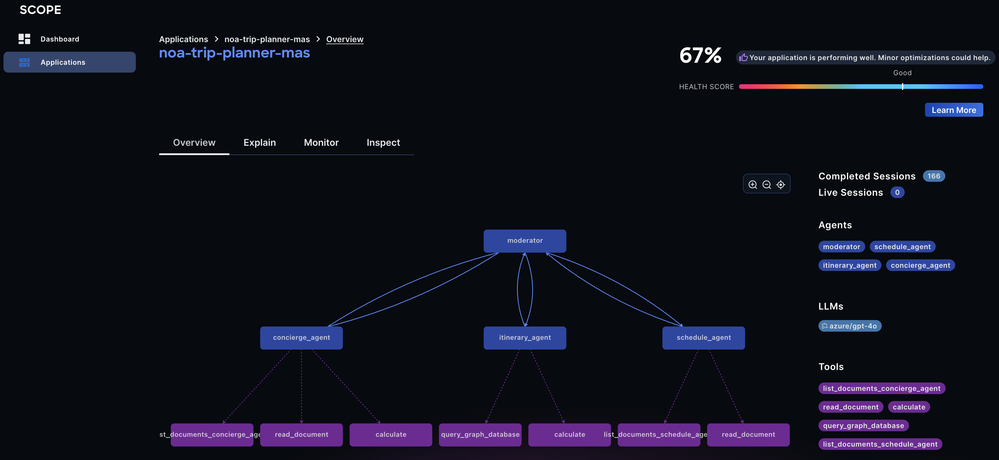

# System for Cognitive Observability Provenance and Explainability (SCOPE)

SCOPE observes, analyzes and explains the executions of Multi-Agent Systems (MAS) from their OpenTelemetry traces. It maps raw spans onto a shared MAS ontology, keeps every execution as a knowledge graph, and enriches each session with analyses such as semantic grouping, anomaly detection, consistency checking, cognitive-failure detection and stateful trajectory evaluation. A web dashboard and an API serve the result.



## Quick start

Run the whole stack on your machine with Docker Compose, send it the trace of a small two-agent example, and look at it in the dashboard. It takes about 15 minutes, most of it the first image build.

You need Docker (Compose v2.17 or later, with at least **12 GB** of memory given to it) and [`uv`](https://docs.astral.sh/uv/) to run the example. An OpenAI-compatible LLM endpoint is only needed for the analyses that call a model: without it, traces are still collected and stored in the knowledge graph.

### 1. Start SCOPE

```bash
git clone https://github.com/ioc-project/scope.git
cd scope/deploy/docker-compose
cp .env.template .env        # set LLM_MODEL_NAME, EMBEDDING_MODEL_NAME, LLM_GATEWAY_* and the change-me passwords
docker compose up -d --build
```

### 2. Send a trace**

```bash
cd ../../examples/currency-demo
OTLP_HTTP_ENDPOINT=http://localhost:4318 uv run main.py 100
```

```text
100.00 USD = 85.90 EUR (example rate)
```

### 3. Look at it

| What | Where |
|---|---|
| Dashboard and API: *Applications* → `currency-demo` → *Inspect* | <http://localhost:8080> |
| The knowledge graph, in the Neo4j browser (`neo4j` and your `NEO4J_PASSWORD`) | <http://localhost:7474> |

The session shows up a few seconds after the example exits. The [first-trace tutorial](docs/tutorials/first-trace.md) walks through each step with screenshots, and explains how to query the knowledge graph.

**Tear down** with `docker compose down` (add `-v` to also delete the data). To run SCOPE on Kubernetes instead, use the [Helm chart](deploy/k8s/charts/scope/README.md). To trace your own application, see [instrument your app](docs/tutorials/instrument-your-app.md); to see how SCOPE evaluates sessions against their peers, follow the [semantic analysis tutorial](docs/tutorials/semantic-analysis.md).

## How it works

1. A MAS sends OTel spans to an OTel collector, which stores them (ClickHouse by default, swappable for another backend).
2. Once a trace is complete, the SCOPE ingestion pipeline maps the raw spans onto the [MAS ontology](ontology), producing a structured execution model: the topology of the system, and for each session its calls, states and transitions.
3. The session is enriched by the analysis workers (semantic grouping, anomaly detection, consistency checking, cognitive failures, stateful evaluation, metrics).
4. The enriched knowledge graph is served through the [API](backend/api) and visualized in the [UI](ui), giving explainability and insight into the MAS's inner workings.

## Documentation

The documentation site is built from [`docs/`](docs/index.md) with `mkdocs.yml` and published at [ioc-project.github.io/scope](https://ioc-project.github.io/scope/):

- **Overview**: [what SCOPE is and how it works](docs/index.md).
- **Ingestion**: [the telemetry path](docs/ingestion/index.md), [normalization](docs/ingestion/normalization/index.md) and [the ontology](https://ioc-project.github.io/scope/ontologies.html).
- **Analysis**: [the analysis engines](docs/analysis/index.md), [pipelines](docs/analysis/pipelines.md), [workers](docs/analysis/workers/index.md) and [components](docs/analysis/components/index.md).
- **Platform**: [the platform](docs/platform/index.md), [API](docs/platform/api/index.md) and [UI](docs/platform/ui/index.md).
- **Tutorials**: [your first trace](docs/tutorials/first-trace.md), [semantic analysis](docs/tutorials/semantic-analysis.md), [instrument your app](docs/tutorials/instrument-your-app.md) and [deploy SCOPE](docs/tutorials/deploy-scope.md).
- Preview locally: `pip install -r docs/requirements.txt && mkdocs serve`.

The ontology reference documentation (Widoco and WebVOWL) is generated separately:

- **Ontology**: [ontology/index.md](ontology/index.md), also published at [ioc-project.github.io/scope/ontologies.html](https://ioc-project.github.io/scope/ontologies.html)

## Repository structure

| Path | Description |
| --- | --- |
| [`backend/`](backend) | Python libraries and workers implementing ingestion, normalization, analysis, and the data API. See [backend/README.md](backend/README.md). |
| [`backend/api`](backend/api) | Unified DB access layer and REST API over the raw OTel spans and the knowledge graph. |
| [`backend/norm`](backend/norm) | Normalizes raw OTel traces into structured MAS execution models. |
| [`backend/mce`](backend/mce) | Metric computation engine for sessions. |
| [`backend/stateful-evals`](backend/stateful-evals) | Cost-effective evaluation of a session's trajectory. |
| [`backend/workers`](backend/workers) | Standalone workers built on top of the backend libraries. |
| [`ui/`](ui) | React/TypeScript web dashboard for browsing applications, sessions, execution graphs, and live topology. See [ui/README.md](docs/platform/ui/index.md). |
| [`ontology/`](ontology) | The MAS telemetry ontology (Turtle/OWL) and the `scope-ontology` Python package. See [ontology/README.md](ontology/README.md). |
| [`docs/`](docs) | Documentation site sources (MkDocs), built with `mkdocs.yml`. |
| [`deploy/`](deploy) | Deployment: Helm charts for Kubernetes (`deploy/k8s`) and a Docker Compose stack (`deploy/docker-compose`) running the API, UI, workers and supporting infra. |

## Contributing

Contributions are welcome — see [CONTRIBUTING.md](CONTRIBUTING.md) for guidelines, [CODE_OF_CONDUCT.md](CODE_OF_CONDUCT.md) for community standards, and [SECURITY.md](SECURITY.md) for reporting vulnerabilities. Maintainers are listed in [MAINTAINERS.md](MAINTAINERS.md).

## License

Licensed under the Apache License 2.0 — see [LICENSE](LICENSE) for the full text.
