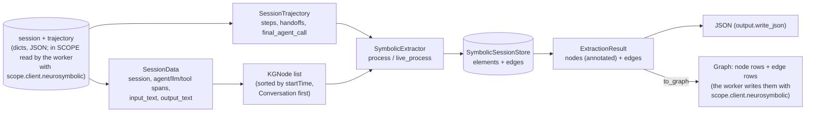
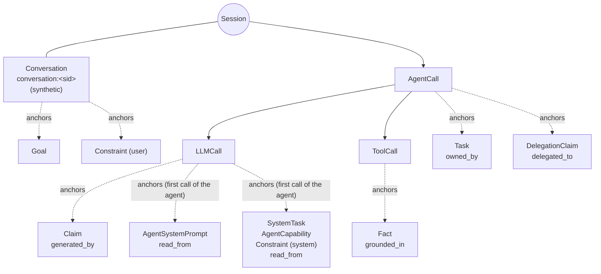
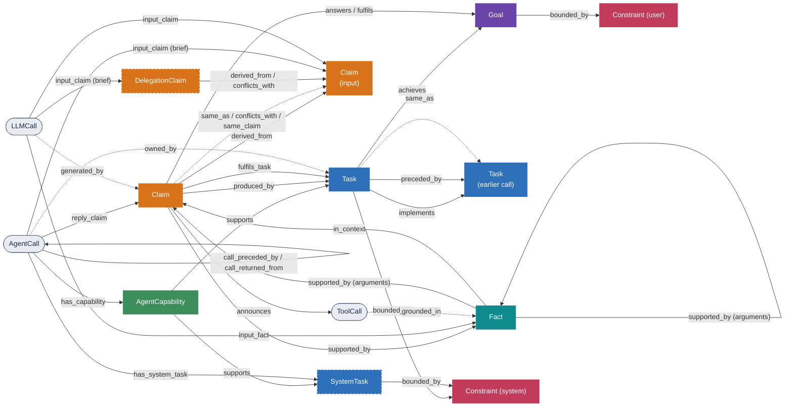

# Symbolic elements and the Knowledge Graph

How every symbolic element (claim, fact, goal, task, ...) is tied to the trajectory in the KG: which KG node it is extracted from, which fields of that node are read, how it is identified, which other elements it is linked to, and **when** in the processing it appears. The README of the package describes the prompts and the output; this document is the map between the elements and the KG.

Everything here was taken from the code (`src/symbolic_extractor/`), and the counts from saved outputs in `output/`. Names in `code font` are the ones of the code and of the output JSON.

- [1. How the layer meets the KG](#1-how-the-layer-meets-the-kg)
- [2. KG nodes used as sources](#2-kg-nodes-used-as-sources)
- [3. Elements: where each one comes from](#3-elements-where-each-one-comes-from)
- [4. Anchor of each element in the KG](#4-anchor-of-each-element-in-the-kg)
- [5. Links between elements (edges)](#5-links-between-elements-edges)
- [6. When things are extracted](#6-when-things-are-extracted)
- [7. Late relations in live mode](#7-late-relations-in-live-mode)
- [8. Copies of the links on the nodes](#8-copies-of-the-links-on-the-nodes)
- [9. Navigating from an element to the KG](#9-navigating-from-an-element-to-the-kg)
- [10. Ontology mapping](#10-ontology-mapping)
- [11. Example: the SRE session](#11-example-the-sre-session)
- [12. Known gaps](#12-known-gaps)

---

## 1. How the layer meets the KG

- **No KG in the library.** The library takes the session and its trajectory as Python objects (`SessionData`, `SessionTrajectory`, from dicts or JSON) and returns an `ExtractionResult`; `to_graph` (`graph.py`) turns it into node and edge rows. Reading the session and writing the rows is the worker's job, through the API library (`scope.client.neurosymbolic`, section 13). The original nodes are only matched, never changed.
- **Two inputs.** The spans of the session (`SessionData`: `agent_spans`, `llm_spans`, `tool_spans`, `input_text`, `output_text`) become the nodes that elements are extracted from. The **trajectory** (`SessionTrajectory`) is the structure of the run: for every call its `call_id`, `kind` (`agent` / `llm` / `tool`), `name`, `agent_id`, `parent_id`, `start_time`, `duration_ms`, `input_text`, `output_text`, plus the `handoffs` between agent calls and the `final_agent_call`. Elements that need the structure (who the agent of an LLM call is, who delegated to whom, which call gave the final answer) are skipped without a trajectory.
- **Two modes.** `process(nodes)` extracts the whole session, nodes sorted by `startTime`, then `annotate()` once. `live_process(node)` handles one node at a time, keeping the store, and returns the edges recorded in this step and the earlier nodes it updated (`updated_nodes`). Both run the same steps per node (section 6).

## 2. KG nodes used as sources

| Node type | Origin | Id | Fields read |
|---|---|---|---|
| `AgentCall` | KG span (`agent_spans`) | KG node id | `inputContent` / `prompt` (the assignment or brief), `outputContent` / `completion` (reply, for the status of the task) |
| `LLMCall` | KG span (`llm_spans`) | KG node id | output: `completion` / `outputContent` (claims); input: `prompt` / `inputContent` (system prompt, conversation, claims given to the call) |
| `ToolCall` | KG span (`tool_spans`) | KG node id | `toolOutput` / `outputContent` (JSON decoded) |
| `Conversation` | **synthetic**, from the initial and final State of the Session (`SessionData.conversation_node()`); not a KG label | `conversation:<session_id>` | `query` (the user input), `response` (the final response) |
| Trajectory | structure computed from the spans and two Cypher queries | n/a | agent of an LLM call (`trajectory.agent_name`), owner agent call of a call, `handoffs`, `final_agent_call`, `final_llm_call()` |

The **node id** is what the store keeps as the anchor of an element (`store.add(kind, element, node_id)`).

## 3. Elements: where each one comes from

Order of the extractors in the pipeline (`pipeline.py`): `claims`, `facts`, `system_prompts`, `system_tasks`, system `constraints`, `capabilities`, `goals`, user `constraints`, `tasks`, `delegation_claims`. The order matters where one element reads another (the system tasks, constraints and capabilities of an agent need its prompt first).

| Key (`symbolic_state_elements.*`) | Class | Extractor | Source node | Reads | LLM | Uses trajectory | Once per |
|---|---|---|---|---|---|---|---|
| `claims` | `Claim` | `ElementExtractor` + `ClaimExtractionPrompt` | `LLMCall` | output (`completion` / `outputContent`); input as context | yes | no | LLM call with a non-empty output |
| `facts` | `Fact` | `ToolResultFactExtractor` | `ToolCall` | `toolOutput` / `outputContent` | no | no | tool call |
| `system_prompts` | `AgentSystemPrompt` | `AgentSystemPromptExtractor` | `LLMCall` | input (system part, via `split_system_prompt`) | no | yes (agent of the call) | **agent**: first call with a readable prompt |
| `system_tasks` | `SystemTask` | `SystemTaskExtractor` | `LLMCall` where the prompt was just read | the prompt element | yes | yes | **agent** |
| `constraints` (origin `system`) | `Constraint` | `SystemConstraintExtractor` | `LLMCall` where the prompt was just read | the prompt element | yes | yes | **agent** |
| `capabilities` | `AgentCapability` | `SystemCapabilityExtractor` | `LLMCall` where the prompt was just read | the prompt element | yes | yes | **agent** |
| `goals` | `Goal` | `ElementExtractor` + `GoalExtractionPrompt` | `Conversation` | `query` (and `response`, only for the status) | yes | no | **session** |
| `constraints` (origin `user`) | `Constraint` | `ElementExtractor` + `UserConstraintPrompt` | `Conversation` | `query` | yes | no | **session** |
| `tasks` | `Task` | `ElementExtractor` + `TaskExtractionPrompt` | `AgentCall` | input (`assignment_text`), output (status) | yes | no | agent call, unless skipped |
| `delegation_claims` | `DelegationClaim` | `DelegationClaimExtractor` | `AgentCall` that received a brief | input (the brief) | yes | yes (`find_caller`) | agent call, unless skipped |

Cards, one per element: what is stored, how the id is made, which fields point at the KG, and what makes the extractor skip.

### `Claim` (`claims`)
- **From:** an `LLMCall`, the text it produced.
- **Id:** `uuid5(OID, "<llm_call_id>|<claim_force>|<claim_text>")`, so the same text with another force is another claim.
- **Fields:** `claim_text`, `claim_force` (`assertive` / `committing` / `directive`), `claim_kind` (`factual` / `evaluative` / `recommendation`; required for assertive, null for committing), `verbatim_source`.
- **KG pointer:** `generated_by` = id of the `LLMCall` (`mas:generatedBy`).
- **Checks:** `verbatim_source` must occur in the output, otherwise the claim is dropped. A call with an empty output is not sent to the LLM, nor is one that only requests tool calls and has no text.
- **Tool calls:** when the output requests tool calls (OTel `tool_call` parts), the prompt lists them (provider id, name, arguments) next to the text. A committing claim that announces them ("Now I will calculate the total travel time") carries `tool_call_ids`, kept only if they occur in that output. Empty for any other claim.
- **Gets afterwards:** `input_claim`, `in_context`, `same_claim`, `same_as`, `conflicts_with`, `derived_from`, `supported_by` (as source towards a fact, and as target of the argument links of a fact), `produced_by`, `announces`, `fulfils_task`, `answers`, `fulfils`, `reply_claim`.

### `Fact` (`facts`)
- **From:** a `ToolCall`, its output as a whole (no LLM, no splitting: `fact_text` = `verbatim_source` = the output).
- **Id:** `uuid5(OID, "<tool_call_id>|fact|<text>")`.
- **Fields:** `fact_text`, `fact_source_type` (`tool_result`), `verbatim_source`, plus `tool_name` and `tool_arguments` (the keyword arguments the tool was called with; not in the ontology). The output stays the exact text agents quote; the two fields say what it is the output of.
- **KG pointer:** `grounded_in` = id of the `ToolCall` (`mas:groundedIn`).
- **Gets afterwards:** `announced_by` (ids of the claims that announce the call, from `announces`). The fact-to-claim judgement shows the model the tool, the arguments and the text of the announcing claim before the output (`describe_fact`), so a bare `5` reads as the result of `calculate({"expression": "3 + 2"})`.
- **Relations afterwards:** `input_fact`, `in_context`, `supported_by` (as target of a claim, and as source of the two argument links: towards the claims and towards the earlier facts its tool call arguments come from).

### `AgentSystemPrompt` (`system_prompts`)
- **From:** the input of an `LLMCall`; the agent comes from the trajectory (`trajectory.agent_name(call)`). The first call of each agent with a readable system prompt gives it; later calls of that agent add nothing, and a call without a readable prompt leaves the agent open for its next call.
- **Id:** `uuid5(OID, "<llm_call_id>|system_prompt|<agent>|<text>")`.
- **Fields:** the prompt text, `agent_id`, `read_from` (the `LLMCall`), `truncated` (the SRE inputs are cut at 4000 characters).
- **Readable formats:** OTel JSON and OpenAI-style message lists. References like `llm-input:<agent>:<uuid>` hold no text: `split_system_prompt` returns None for them.
- **Role:** a source for the next three elements. No edge in the store; in the KG it is the `mas:SystemPrompt` node (`systemPromptOf` -> `Agent`) that those elements point to with `definedIn` (section 10).

### `SystemTask` (`system_tasks`), `AgentCapability` (`capabilities`), `Constraint` origin `system` (`constraints`)
- **From:** the system prompt of an agent, read by an LLM request, run **on the same `LLMCall`** where the prompt element was just created (that is why they come right after `AgentSystemPromptExtractor`). One request each, once per agent and session.
- **Ids:** `uuid5(OID, "<prompt_id>|system_task|<text>")`, `...|capability|<text>`, `...|constraint|system|<text>`.
- **KG pointers:** `agent_id`, `system_prompt_id`, `read_from` (the `LLMCall`), `truncated`.
- **Constraint extras:** `strength` (`hard` / `soft`); `SystemTask` has no status or `inferred`.
- **Belong to the agent**, not to the call where they were read: they are linked to **every** `AgentCall` of the agent (`has_system_task`, `has_capability`), the earlier ones included.

### `Goal` (`goals`)
- **From:** the synthetic `Conversation` node, `query` (what the user asked); the `response` only sets the status.
- **Id:** `uuid5(OID, "conversation:<sid>|goal|<goal_text>")`.
- **Fields:** `goal_text`, `success_criteria` (at least one), `rationale`, `inferred`, `status` (`set` / `decomposed` / `achieved` / `abandoned`).
- **KG pointer:** none on the element; the anchor is the Conversation node (`conversation:<sid>`).
- **Status:** replaced later by `GoalClaimRelationExtractor` (`achieved` / `abandoned` / `set`).

### `Constraint` origin `user` (`constraints`)
- **From:** `Conversation`, `query`. **Id:** `uuid5(OID, "conversation:<sid>|constraint|user|<text>")`. **KG pointer:** `read_from` = `conversation:<sid>`. `strength` `hard` / `soft`.

### `Task` (`tasks`)
- **From:** an `AgentCall`: its input is the assignment (cleaned by `assignment_text`: the `input:<agent>:` prefix and the `ROUND=..;TARGET=..;` header dropped, LangGraph message lists turned into `[sender]: content`). Its output only sets the status.
- **Id:** `uuid5(OID, "<agent_call_id>|task|<task_text>")`.
- **Fields:** `task_text`, `acceptance_criteria`, `inferred` (forced `True` when the input looks cut off: 1500 characters or more that do not end in `.`, `!` or `?`), `status` (`assigned` / `accepted` / `in_progress` / `complete` / `failed`).
- **KG pointer:** `owned_by` = id of the `AgentCall` (`mas:ownedBy`). The delegator (`mas:createdBy`) is not extracted.
- **Skipped without an LLM request** (`skip_reason`): empty input, a bare resume marker (`...resume-2`), or an output that is only a routing command (`{"next": ...}` / `goto`).
- **Context given to the LLM:** the tasks already extracted in the session (at most 10, `earlier_tasks`), only so the same work gets the same wording.

### `DelegationClaim` (`delegation_claims`)
- **From:** an `AgentCall` that received a brief. The caller is found with `find_caller`: the last LLM call of an agent call whose output is `delegate_to_x` / `transfer_to_x` / `handoff_to_x` and that ended before the receiver started.
- **Id:** `uuid5(OID, "<agent_call_id>|delegation|<claim_force>|<text>")`.
- **KG pointers:** `generated_by` = the caller's `LLMCall`, `caller_agent`, `caller_call`, `delegated_to` = the receiving `AgentCall`. `verbatim_source` is an excerpt of the brief.
- **Skipped:** no caller found, empty or marker input, `relay` (every claim of the caller occurs verbatim in the brief: nothing new), `history` (the caller's own input occurs as a block in the brief).
- **No ontology class** (it is a `Claim` whose speaker is the caller).

## 4. Anchor of each element in the KG

| Element | Anchor node (`node_id` in the store) | Field that names it | Scope in the run |
|---|---|---|---|
| `Claim` | `LLMCall` | `generated_by` | one call |
| `Fact` | `ToolCall` | `grounded_in` | one call |
| `Task` | `AgentCall` | `owned_by` | one call |
| `DelegationClaim` | receiving `AgentCall` | `delegated_to` (+ `generated_by`, `caller_call`) | one call |
| `Goal` | `Conversation` | none | the session |
| `Constraint` (user) | `Conversation` | `read_from` | the session |
| `AgentSystemPrompt` | first `LLMCall` of the agent | `read_from`, `agent_id` | the agent, all its calls |
| `SystemTask` / `AgentCapability` / `Constraint` (system) | same `LLMCall` as the prompt | `read_from`, `agent_id`, `system_prompt_id` | the agent, all its calls |

An element anchored on one call but valid for the whole agent (the last row) reaches the other calls through edges: `AgentCall -has_system_task-> SystemTask`, `AgentCall -has_capability-> AgentCapability`, `Task / SystemTask -bounded_by-> Constraint`.

## 5. Links between elements (edges)

Every relation is stored as an `Edge(edge_type, source_id, target_id, attributes)` in the store (`store.link()`, idempotent). The ids are element ids, except where a **node** id is used (marked `(node)`). `result.edges` has all of them (`process`) or the new ones of the step (`live_process`). The "How" column: **det** = deterministic code, **LLM** = a request to the model, **emb** = embeddings.

### 5.1 Structure of the run and of the context

| Edge | From -> to | Meaning | How | Produced by | Needs |
|---|---|---|---|---|---|
| `call_preceded_by` | `AgentCall` (node) -> `AgentCall` (node) | the call that handed the work over (route / handoff / sequence) | det | `symbolic_state.track_symbolic_state` | trajectory; order from KG `handoffs` / `shared_state`, else goto heuristics |
| `call_returned_from` | router `AgentCall` (node) -> worker `AgentCall` (node) | the worker whose result came back to the router (`return`) | det | same | same |
| `input_claim` | `LLMCall` (node) -> `Claim` | the claim, produced earlier, is in the input of the call (`verbatim_source` occurs in the conversation part of the input; the system prompt is ignored) | det | `_track_input_claims` | claims of earlier nodes |
| `input_claim` | `AgentCall` (node) -> `Claim` | claim of the delegation brief (at most 40, `source_claims`) | det | `_link_source_claims` | delegation claims |
| `input_claim` | `LLMCall` (node) -> `DelegationClaim` | the brief reaches each LLM call of that agent call that produced claims | det | `_link_brief_to_llm_calls` | same |
| `input_claim` | receiver `LLMCall` (node) -> `Claim` | a reply (see `reply_claim`) reaches the call that received it | det | `_link_replies` | reply claims |
| `input_fact` | `LLMCall` (node) -> `Fact` | the tool result is in the input of the call: of the tool calls of the same agent call that had finished when the LLM call started (facts do not cross agent calls), those whose `verbatim_source` occurs in the conversation part of the input. With `--no-fact-match` (`match_input_facts=False`) the text check is skipped: all of them are input facts (the inputs of the SRE session are cut, so the check finds none there) | det | `_track_input_claims` (`track_input_facts`) | facts of earlier nodes |
| `in_context` | `Fact` -> `Claim` | the claim was generated by a call that had the fact in its input | det | `_track_input_claims` | `input_fact` |
| `same_claim` | `Claim` -> input `Claim` | same statement, by embedding similarity (threshold 0.7) | emb | `comparison.annotate_same_claims` (`_link_same_claims_live`) | embedder (off with `--no-same-claims`) |

### 5.2 Between claims and facts

| Edge | From -> to | Meaning | How | Produced by | Needs |
|---|---|---|---|---|---|
| `supported_by` | `Claim` -> `Fact` | the fact backs the claim; one yes/no request per (fact, claim) pair among the facts `in_context` | LLM | `FactClaimLinker` | `in_context` |
| `supported_by` (`arguments`) | `Fact` -> `Claim` | the fact (result) of a tool call is supported by the claims its agent had made before the call (claims of its earlier LLM calls, the requesting one included, and of the brief it received) that its arguments come from; one request per tool call with arguments; edge attribute `arguments` (name -> `stated` / `derived`); verdicts (basis, reasoning, arguments traced to no claim) in `argument_origins` | LLM | `ArgumentOriginExtractor` (`relations/argument_origin_relations.py`) | trajectory, claims, `announces` (marks the claims announcing the call); judged when the ToolCall node is processed |
| `supported_by` (`arguments`) | `Fact` -> `Fact` | the fact (result) of a tool call is supported by the facts (results) of earlier tool calls of the same agent call that hold its string arguments, as seen by the requesting LLM call; echoes of the same value are dropped and the earliest source is kept; edge attribute `arguments` (name -> value). To be compared with an LLM extraction | det | `ArgumentFactLinker` (`relations/argument_fact_links.py`) | trajectory (timestamps, requesting LLM call), facts; judged when the ToolCall node is processed |
| `same_as` | `Claim` <-> `Claim` | same claim (both directions are stored) | LLM | `ClaimRelationExtractor` | input claims |
| `conflicts_with` | `Claim` <-> `Claim` | contradicting claims (symmetric) | LLM | `ClaimRelationExtractor` | input claims |
| `derived_from` | `Claim` -> `Claim` | the new claim is built on an earlier one | LLM | `ClaimRelationExtractor` (also on delegation claims, `_relate_delegation_claims`) | input claims |

The `supported_by` relation has three kinds of edge, told apart by the kind of their two ends (and by the `arguments` attribute of the last two). All three are in the ontology: `mas:supportedBy` has the union Claim / Fact as domain and Fact / Claim as range, with one shape per source class (`mas:ClaimSupportedByShape`: a Claim points to a Fact; `mas:FactSupportedByShape`: a Fact points to a Fact or a Claim), and the KG writer writes them. The `arguments` attribute is not written (an edge attribute has no place in the ontology yet). The first kind does not fully match: the ontology allows `mas:supportedBy` from a claim only when it is factual (the others should use `mas:groundedOn`, which the code never writes), and `FactClaimLinker` links a claim of any kind.

`ClaimRelationExtractor` makes one request per LLM call; it is skipped when the call has no input claim and a single claim.

### 5.3 Between tasks, goals and the agent

| Edge | From -> to | Meaning | How | Produced by | Needs |
|---|---|---|---|---|---|
| `same_as` | `Task` <-> `Task` | identical text key (`same_task_key`: case, spaces, final punctuation ignored) | det | `_link_same_task` | tasks of two calls |
| `preceded_by` | `Task` -> `Task` | task of the closest earlier agent call that has tasks (follows `call_preceded_by`, and `call_returned_from` through a router without tasks, not from the start call) | det | `_link_preceding_tasks` (`_closest_tasks`) | `call_preceded_by` |
| `implements` | `Task` -> `Task` | the task carries out one of the preceding call; one request per task; skipped when a predecessor has a `same_as` identical task | LLM | `TaskRelationExtractor` | `preceded_by` |
| `achieves` | `Task` -> `Goal` | only for a task with **no** predecessor | LLM | `TaskRelationExtractor` | goal |
| `produced_by` | `Claim` -> `Task` | the claim was generated inside the agent call that owns the task (all the tasks of that call) | det | `_link_produced_by` | trajectory (owner call of the `LLMCall`), task |
| `fulfils_task` | `Claim` -> `Task` | the claim delivers what the task asked; one request per task on the claims of the call | LLM | `TaskClaimRelationExtractor` | `produced_by`; the `AgentCall` processed before its `LLMCall`s; results in `task_evaluations` |
| `announces` | `Claim` -> `ToolCall` (node) | the committing claim announces the tool call(s) the LLM call requested; the `ToolCall` node has no provider id, so it is found in the trajectory: same agent call, after the LLM call and before its next one, same arguments, compatible name (`list_documents` ~ `list_documents_schedule_agent`) | det | `_link_announces` (`tool_calls.match_tool_calls`) | `tool_call_ids` of the claim; trajectory with the tool step (late relation in live mode). Needs the tool calls in the LLM output: SRE outputs are `llm-output:` references, so no link there. Ontology: `mas:announces` (Claim -> ToolCall, committing claims only) |
| `has_system_task` | `AgentCall` (node) -> `SystemTask` | duty of the agent, from its system prompt; to **every** call of the agent | det | `_link_system_tasks` | trajectory, system task |
| `has_capability` | `AgentCall` (node) -> `AgentCapability` | the agent can do this; to every call of the agent | det | `_link_capabilities` | trajectory, capability |
| `bounded_by` | `Goal` -> `Constraint` (user) | user constraint on the goal (same Conversation node) | det | `_link_constraints` | none |
| `bounded_by` | `Task` / `SystemTask` -> `Constraint` (system) | system constraint of the agent on the work of every call of that agent | det | `_link_constraints` | trajectory |
| `supports` | `AgentCapability` -> `Task` / `SystemTask` | the capability lets the agent do the task; one request per task, once the capabilities of the agent are known; candidates through `has_capability` (task) or `agent_id` (system task); a system task is judged once; failures are logged, not retried | LLM | `CapabilityTaskRelationExtractor` | capabilities, results in `capability_evaluations` |

### 5.4 Between claims, the final answer and the goal

| Edge | From -> to | Meaning | How | Produced by | Needs |
|---|---|---|---|---|---|
| `answers` | `Claim` -> `Goal` | every claim of the **final** LLM call (the last `LLMCall` of `final_agent_call`) | det | `_link_answers` | trajectory: `final_llm_call()`; the final agent call comes from a Cypher query on the final State |
| `fulfils` | `Claim` -> `Goal` | the answer claim meets the success criteria; one request, repeated if the set of answer claims changes; also sets the goal status | LLM | `GoalClaimRelationExtractor` | all `answers`; results in `goal_evaluations` |
| `reply_claim` | `AgentCall` (node) -> `Claim` | claim of its LLM calls whose `verbatim_source` occurs in the reply of the agent call (`delegated_reply`, `reply_receiver`) | det | `_link_replies` | trajectory |

### 5.5 Diagram of the links between elements

Colours: grey rounded nodes are the nodes of the KG (`AgentCall`, `LLMCall`, `ToolCall`); the coloured nodes are the symbolic elements (purple goal, blue tasks and system tasks, orange claims, teal facts, red constraints, green capabilities). A dashed border marks an element with no ontology class of its own (`SystemTask` is a `mas:Task` with `mas:source = 'system'`, `DelegationClaim` a `mas:Claim`).

Dotted lines to the KG nodes are the pointer fields of the elements (not edges in the store).

## 6. When things are extracted

### 6.1 Order of the nodes

Nodes are processed in `startTime` order, the synthetic `Conversation` first. In `live_process` this is the order the caller feeds them; in `process` the extractor sorts them itself. A node is therefore processed after everything that started before it, and an element can only link to elements that already exist at that time (the late cases are in section 7).

### 6.2 What happens for one node

Same steps in `process` and `live_process` (`extractor.py`):

| # | Step | Function | Creates |
|---|---|---|---|
| 1 | Extract the node's elements | `_extract_node` (extractors in the order of section 3, those that apply to the node type) | elements in `symbolic_state_elements`; store anchor = this node |
| 2 | Track what the node received | `_track_input_claims` / `track_symbolic_state` | `input_claim`, `input_fact`, `in_context`, `call_preceded_by`, `call_returned_from` |
| 3 | Same claims by embedding | `_link_same_claims_live` | `same_claim` |
| 4 | Same task | `_link_same_task` | `same_as` (Task) |
| 5 | Preceding tasks | `_link_preceding_tasks` | `preceded_by` |
| 6 | Claim to task | `_link_produced_by` | `produced_by` |
| 6b | Claim to tool call | `_link_announces` | `announces` |
| 7 | Agent duties | `_link_system_tasks` | `has_system_task` |
| 8 | Agent capabilities | `_link_capabilities` | `has_capability` |
| 9 | Constraints | `_link_constraints` | `bounded_by` |
| 10 | Brief claims | `_link_source_claims` | `input_claim` (brief) |
| 11 | Replies | `_link_replies` | `reply_claim` (+ `input_claim`) |
| 12 | Relations | `_extract_relations` (per node: `_extract_node_relations`) | delegation claims: `same_as`, `conflicts_with`, `derived_from`; `ToolCall` node: `supported_by` (fact -> claim, LLM) and `supported_by` (fact -> fact, det); then `supported_by` (claim -> fact), `same_as`, `conflicts_with`, `derived_from`, `implements`, `achieves`, `fulfils_task` |
| 13 | Capability judgement | `_evaluate_capabilities` | `supports` |
| 14 | Final answer | `_link_answers` | `answers` |
| 15 | Goal judgement | `_evaluate_goals` | `fulfils`, goal status |
| 16 | Result | `result.edges = edges_since(...)` (live) / `store.edges()` (process) | |
| 17 | Refresh annotations | `_refresh` (live: nodes touched by this step; `process`: `annotate()` once at the end) | the copies of section 8 |

In step 12 the order is: `_relate_delegation_claims` (the `ClaimRelationExtractor` on the brief), `_judge_tool_arguments` (`ArgumentOriginExtractor`, LLM, only for a `ToolCall` node with an output and arguments), `_link_tool_arguments` (`ArgumentFactLinker`, no LLM), then the loop over the extractors of the node: `FactClaimLinker`, `ClaimRelationExtractor`, `TaskRelationExtractor`, `TaskClaimRelationExtractor`. The other relation extractors are run elsewhere: `CapabilityTaskRelationExtractor` in step 13 and `GoalClaimRelationExtractor` in step 15. `ArgumentOriginExtractor` and `ArgumentFactLinker` are opt-in: they only run when they are in `relation_extractors` (the CLI has them). An extractor that fails is logged and skipped.

### 6.3 When each element and each link first appears

| Element / link | Earliest moment | Why it cannot be earlier |
|---|---|---|
| `Goal`, user `Constraint` | the first node (`Conversation`) | only needs the query |
| `bounded_by` (Goal -> user) | the first node | same Conversation node |
| `Claim` | its `LLMCall` | needs the call output |
| `Fact` | its `ToolCall` | needs the tool output |
| `Task` | its `AgentCall` | needs the input of the call |
| `DelegationClaim` | the receiving `AgentCall` | needs the caller found in the trajectory |
| `AgentSystemPrompt`, `SystemTask`, `AgentCapability`, system `Constraint` | the **first `LLMCall` of the agent with a readable prompt**, which comes **after** that agent's first `AgentCall` | the prompt is only in the input of an LLM call |
| `has_system_task`, `has_capability`, `bounded_by` (system) | the same node; they also reach the agent calls that came before | they link to all calls of the agent |
| `supports` | the node where the capabilities of the agent become known (first task of the agent: one node later) | needs both the capability and the task |
| `produced_by`, `fulfils_task` | the `LLMCall` of the claim | the `AgentCall` that owns the task is processed before its LLM calls; the judgement needs the claims |
| `announces` | the node where both ends are there | needs the claim and the `ToolCall` step in the trajectory; late if the tool call runs after the claim's call was returned |
| `supported_by` (arguments, fact -> claim / fact) | the `ToolCall` node | the claims of the agent call before the tool call, and the results of the earlier tool calls, are already in the store (nodes come in start order) |
| `input_claim`, `input_fact`, `in_context` | the node that receives them | the claim or fact must be older |
| `reply_claim` | when the reply is known | needs the reply of the agent call |
| `answers`, `fulfils` | the claims of the **final** LLM call | the final agent call is known from the KG; `fulfils` waits for all answer claims |
| `implements` / `achieves` | the node of the task | the preceding tasks must exist |

## 7. Late relations in live mode

A relation can be established after the node it belongs to was already returned. Examples: the first agent call of an agent is returned before its system prompt is read (`has_system_task: []` and `has_capability: []` until the first LLM call of the agent); the first task of an agent is linked to a capability only when the capabilities arrive; a claim anchored on an earlier node receives a `reply_claim` or `input_claim` later.

How the layer handles it:
1. The new edge is in `result.edges` of the step where it appeared (`edges_since`), whatever the age of its end points.
2. The earlier nodes whose copy of the link (section 8) changed are in `result.updated_nodes`, already modified in place.
3. A consumer that keeps results (a stream, a KG writer) must treat `edges` as the source of truth, and replace its copy of each `updated_nodes` node (match `node_id`, the latest wins).

Not updated live: the attributes `same_as`, `conflicts_with`, `derived_from`, `supported_by`, `implements`, `achieves`, `preceded_by`, `same_claims` on the nodes (set when the node is processed; the edges are complete). A task or system task not judged yet has `supported_by_capabilities: []`, like one no capability supports.

## 8. Copies of the links on the nodes

The links are also written onto the nodes (and the elements) that `annotate()` produces, for consumers that read nodes and not edges. The edge is the truth; the copy is a convenience.

| Copy | On | Mirrors |
|---|---|---|
| `produced_by` | `Claim` | `produced_by` |
| `announces` | `Claim` (ids of the `ToolCall` nodes) | `announces` |
| `announced_by` | `Fact` (ids of the claims announcing its tool call) | `announces`, read backwards |
| `system_tasks`, `capabilities` | `AgentCall` | `has_system_task`, `has_capability` |
| `bounded_by` | `Task`, `SystemTask`, `Goal` | `bounded_by` |
| `source_claims` | `AgentCall` | `input_claim` (brief) |
| `input_claims`, `input_facts` | `LLMCall` | `input_claim`, `input_fact` |
| `reply` | `Claim` | `reply_claim` |
| `answers`, `fulfils` | `Claim` | `answers`, `fulfils` |
| `supported_by_capabilities` | `Task`, `SystemTask` | `supports` |
| `status` | `Goal` | set by `GoalClaimRelationExtractor` |
| `same_as`, `conflicts_with`, `derived_from`, `supported_by`, `implements`, `achieves`, `preceded_by`, `same_claims` | elements | the edge of the same name (not refreshed live) |

No copy on the nodes for the two `supported_by (arguments)` edges: the verdicts of `ArgumentOriginExtractor` are in `evaluations["argument_origins"]` of the result (basis and reasoning of each argument, and the arguments traced to no claim, which have no edge), and the claims page reads them from there. `supported_by` on a claim is the claim -> fact edge only.

## 9. Navigating from an element to the KG

| Question | Path |
|---|---|
| Which LLM call produced this claim? | `claim.generated_by` -> `LLMCall` node |
| Which agent produced it? | `LLMCall` id -> `trajectory.agent_name` / `agent_id` of the step |
| Within which agent call? | the step's `parent_id` / owner agent call -> `AgentCall` node |
| Which task was the agent working on? | `Claim -produced_by-> Task` (`task.owned_by` = the `AgentCall`) |
| Did the claim deliver the task? | `Claim -fulfils_task-> Task` |
| Which tool output backs the claim? | `Claim -supported_by-> Fact`, `fact.grounded_in` -> `ToolCall` node |
| Which claims did a tool call take its arguments from? | `Fact -supported_by-> Claim` (attribute `arguments`; the fact is the one whose `grounded_in` is the tool call) |
| Which earlier tool results did a tool call take its arguments from? | `Fact -supported_by-> Fact` (attribute `arguments`), same agent call |
| Which claim announced this tool call? | `Claim -announces-> ToolCall` (`fact.announced_by`) |
| What did the call receive? | `LLMCall -input_claim-> Claim`, `-input_fact-> Fact` |
| Which agent call asked for this work? | `AgentCall -call_preceded_by-> AgentCall`; the brief: `DelegationClaim` with `caller_call` / `generated_by` |
| What was the agent supposed to do and allowed to do? | `AgentCall -has_system_task-> SystemTask`, `-has_capability-> Capability`, `Task -bounded_by-> Constraint` |
| Which capability backs a task? | `Capability -supports-> Task` |
| Which claims are the final answer, and does it meet the goal? | `Claim -answers-> Goal`, `Claim -fulfils-> Goal` (`final_agent_call` from the KG) |
| Where does the task lead to? | `Task -implements-> Task` ... `-achieves-> Goal` |
| Where in the prompt of the agent was this read? | `read_from` (`LLMCall`), `system_prompt_id` -> `AgentSystemPrompt`, `truncated` |

## 10. Ontology mapping

Ontology: `ontology/src/scope_ontology/neurosymbolic-ontology.ttl` (`mas:` namespace).

| Store | Ontology | Note |
|---|---|---|
| `Claim`, `Fact`, `Goal`, `Task`, `Constraint`, `AgentCapability` | `mas:Claim`, `mas:Fact`, `mas:Goal`, `mas:Task`, `mas:Constraint`, `mas:AgentCapability` | `mas:Capability` is the structural parent of LLM, Tool and Processing, so the symbolic one is `AgentCapability` (text: `mas:agentCapabilityText`; the agent is reached through its `SystemPrompt`) |
| `generated_by`, `grounded_in`, `owned_by` | `mas:generatedBy`, `mas:groundedIn`, `mas:ownedBy` | pointer fields |
| `supported_by`, `derived_from`, `conflicts_with`, `same_as`, `achieves`, `implements`, `preceded_by`, `bounded_by`, `supports`, `produced_by`, `answers`, `fulfils` | `mas:supportedBy`, `mas:derivedFrom`, `mas:conflictsWith`, `mas:sameAs`, `mas:achieves`, `mas:implements`, `mas:precededBy`, `mas:boundedBy`, `mas:supports`, `mas:producedBy`, `mas:answers`, `mas:fulfils` | `supported_by` is Claim -> Fact, Fact -> Fact (an argument of a tool call found in an earlier result) and Fact -> Claim (an argument traced to a claim): the three are written, but not the `arguments` attribute of the last two (no place for an edge attribute). The ontology also restricts `mas:supportedBy` from a claim to claims with `claimKind = 'factual'` (`mas:ClaimFactLinkShape`; the other claims use `mas:groundedOn`), while `FactClaimLinker` does not look at the kind. `same_as` is Claim <-> Claim or Task <-> Task; `fulfils` goes to a Goal or a Task; `implements` is Task -> Task only (the writer would also accept a Goal as target, the extractor never makes one) |
| `announces` | `mas:announces` | Claim -> ToolCall, committing claims only (`mas:AnnouncesCommittingShape`): `tool_call_ids` are only kept for a committing claim, so the code respects it; a tool call requested with no text is not announced |
| `input_claim`, `input_fact`, `in_context` | `mas:inputClaim`, `mas:inputFact`, `mas:inContext` | the ontology source is an `LLMCall`; the store also uses an `AgentCall` as source (delegation brief) |
| `AgentSystemPrompt` | `mas:SystemPrompt` (`systemPromptText`; `mas:systemPromptOf` -> `Agent`; `truncated` stays in the JSON only) | its `agent_id` is the name of the `Agent` node |
| `SystemTask` | `mas:Task` with `mas:source = 'system'` | standing task, no `ownedBy` |
| `system_prompt_id` of tasks, capabilities, system constraints | `mas:definedIn` -> `mas:SystemPrompt` | these also carry `mas:source = 'system'` (user constraints: `'user'`) |
| `DelegationClaim` | `mas:Claim` | extra fields (`caller_agent`, ...) are not written |
| `has_system_task`, `has_capability`, `reply_claim`, `call_preceded_by`, `call_returned_from`, `same_claim` | **none** | |
| not produced | `mas:groundedOn`, `mas:decomposedInto`, `mas:delegatesTo`, `mas:createdBy` | the code does not create them (the delegator of a task, `mas:createdBy`, is not extracted either) |

The synthetic **Conversation** node has no counterpart in the KG schema and is not written (`goalOf` point at a `MASCall`).

## 11. Example: the SRE session

Session `d88018ed` (75 nodes, 286 edges, saved in `output/`).

| Element | Count | | Edge | Count |
|---|---|---|---|---|
| `goals` | 1 | | `bounded_by` | 76 |
| `tasks` | 5 | | `input_claim` | 45 |
| `system_prompts` | 5 | | `produced_by` | 27 |
| `system_tasks` | 10 | | `supports` | 24 |
| `constraints` | 28 | | `reply_claim` | 23 |
| `capabilities` | 9 | | `has_system_task` | 22 |
| `facts` | 49 | | `fulfils_task` | 19 |
| `claims` | 28 | | `has_capability` | 17 |
| `delegation_claims` | 4 | | `same_as` | 10 |
| | | | `derived_from` | 7 |
| | | | `call_preceded_by` | 6 |
| | | | `preceded_by` | 4 |
| | | | `conflicts_with` / `implements` | 2 / 2 |
| | | | `achieves` / `answers` | 1 / 1 |

Four sessions have edges today (`4493f565`, `7454b5fa`, `d88018ed`, `eeec0920`); the other saved ones were written before edges existed and must be extracted again.

## 12. Known gaps

- **Write-back is limited to the ontology.** Only what `neurosymbolic-ontology.ttl` describes is written (section 13); the synthetic `Conversation`, the relations without an ontology property and the two `supported_by (arguments)` edges are counted in `skipped` and stay in the JSON and the store.
- **Ontology is incomplete** for `DelegationClaim` (written as a `Claim`, its extra fields are lost), for six edge types without a property (section 10) and for the attributes of an edge (`arguments` on the fact -> fact and fact -> claim `supported_by`). `SystemTask` and `AgentSystemPrompt` are covered (`mas:Task` with `source = 'system'`, `mas:SystemPrompt`).
- **`supported_by` vs the ontology shape:** `mas:ClaimFactLinkShape` allows `mas:supportedBy` only on `factual` claims; `FactClaimLinker` judges every claim, so a written evaluative or committing claim with a `supportedBy` edge would fail the SHACL check. Either the linker should only judge factual claims (and use `groundedOn` for the others) or the shape should be relaxed.
- **Edges carry attributes only for the tool call arguments** (`arguments` on the two `supported_by` edges). The reasoning of the other judgements stays in `task_evaluations`, `capability_evaluations`, `goal_evaluations` (and `argument_origins` for the arguments) of the pipeline, not in the output file edges.
- **Tool call arguments:** `ArgumentFactLinker` is a heuristic (a derived or reformatted value is missed, a common value can match by chance, a skill result can be the source); `ArgumentOriginExtractor` is a judgement of an LLM. Neither has been compared with the other yet.
- **System prompts** can be truncated (SRE inputs are cut at 4000 characters, `truncated: true`) or unreadable (references such as `llm-input:<agent>:<uuid>`, webex): then no per-agent element exists for that agent.
- **One Conversation per session.** A multi-turn session still gets one goal set from the whole query.
- **Late relations** in live mode need `updated_nodes` (section 7); the late `reply` case was not tested.
- **`ClaimRelationExtractor` and `FactClaimLinker`** judge per call and per pair: the cost grows with the claims and the facts in context.
- **Order dependence:** `AgentCall` before its `LLMCall`s (for `fulfils_task`), prompt before its derived elements, capabilities before `supports`. A node feed that breaks the `startTime` order breaks these.

## Where it is in the code

| Topic | Location |
|---|---|
| Session and trajectory (input) | `models.py` (`SessionData`, `SessionTrajectory`); read from the KG by `scope.client.neurosymbolic.get_symbolic_extraction_input` |
| Elements and edges | `models.py`, `store.py` (`SymbolicSessionStore`, `Edge`, `link`, `edges_since`) |
| Per-node pipeline, annotations, live | `extractor.py` (`process`, `live_process`, `annotate`, `_refresh`, the `_link_*` methods) |
| Extractors | `extractors/` (`claims`, `facts`, `system_prompts`, `system_tasks`, `constraints`, `capabilities`, `goals`, `tasks`, `delegation_claims`) |
| LLM relations | `relations/` (`fact_claim_links`, `claim_claim_relations`, `task_relations`, `goal_claim_relations`, `task_claim_relations`, `task_capability_relations`, `argument_origin_relations`) |
| Deterministic relation extractor | `relations/argument_fact_links.py` (`ArgumentFactLinker`) |
| Tool calls: matching with the claims that announce them | `tool_calls.py` (`match_tool_calls`) |
| Context tracking | `symbolic_state.py` (`track_symbolic_state`) |
| Same claims by embedding | `comparison.py` (`annotate_same_claims`) |
| Pipeline order | `pipeline.py` (`build_pipeline`) |

## 13. Writing to the KG

The worker (`workers/symbolic-extractor-worker`) writes the result: `graph.to_graph` (`graph.py`) maps it to nodes and edges, and `scope.client.neurosymbolic.write_symbolic_state` (Cypher in `scope.query_builders.neurosymbolic`) writes them. The library never talks to Neo4j itself, and what the worker reads (the session, its trajectory, the handoffs, the final call) also comes from `scope.client.neurosymbolic`.

It writes **only what `neurosymbolic-ontology.ttl` describes**, under its names:

- **Nodes:** `Claim`, `Fact`, `Goal`, `Task`, `Constraint`, `AgentCapability`, `SystemPrompt`, MERGEd on `id`, with the ontology's data properties (`claimText`, `systemPromptText`, `agentCapabilityText`, ...) plus `sessionId` (to clean a session). Delegation claims are written as ordinary `Claim` nodes.
- **System prompts:** each `SystemPrompt` is linked to its `Agent` (`systemPromptOf`, the existing Agent node matched by name). The standing tasks (written as `Task`, with no `ownedBy`), the capabilities and the system constraints read from it are linked to it with `definedIn` and carry `source = 'system'` (user constraints carry `source = 'user'`). `MATCH (n {source: 'system'})` finds everything that comes from a system prompt.
- **Edges:** the relations of `ONTOLOGY_EDGES` (`generatedBy`, `groundedIn`, `ownedBy`, `announces`, `supportedBy`, `derivedFrom`, `conflictsWith`, `sameAs`, `producedBy`, `answers`, `fulfils`, `achieves`, `implements`, `precededBy`, `boundedBy`, `supports`, `definedIn`, `systemPromptOf`, `inputClaim`, `inputFact`, `inContext`), each checked against the labels of its two ends. `supportedBy` is Claim -> Fact, Fact -> Fact or Fact -> Claim, so the `supported_by` edges of the tool call arguments are written too (without their `arguments` attribute).
- **Left out on purpose:** the synthetic `Conversation` node, the relations `has_system_task`, `has_capability`, `reply_claim`, `call_preceded_by`, `call_returned_from`, `same_claim`, `goalOf` (their target is a `MASCall` the extraction does not carry), and the tool name and arguments of facts. They are counted in the report (`skipped`).
- **Original nodes** (`Agent`, `AgentCall`, `LLMCall`, `ToolCall`) are only matched, never changed. Missing ones and the edges not written are reported.
- **Re-runs:** ids are deterministic, so the same result writes the same nodes. A new extraction can word claims differently (new ids): `--replace-kg` deletes the session's symbolic state first.
