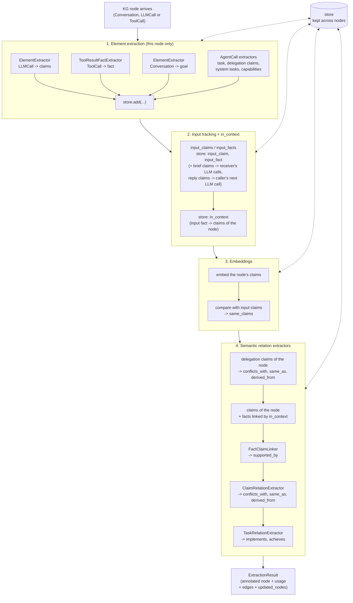

# Symbolic state element extractor works

## Usage

Run everything from `backend/symbolic-extractor/` with [uv](https://docs.astral.sh/uv/). The SCOPE libraries and `dem` are members of the `backend/` uv workspace. `dem` is in the `embeddings` extra, so install it once:

```bash
uv sync --python 3.13 --extra embeddings --extra dev
```

`--python 3.13` is needed because `gensim` (a dependency of `dem`) has no wheel for Python 3.14 yet. Then every command below is run with `uv run`.

### Configuration (`.env` in this folder, or exported variables)

| Variable | Used for | Default |
|---|---|---|
| `NEO4J_HOST` / `NEO4J_URI`, `NEO4J_PORT`, `NEO4J_USERNAME`, `NEO4J_PASSWORD`, `NEO4J_DATABASE` | Reading the session from the SCOPE KG (not needed with `--from-file`) | SCOPE API settings |
| `OPENAI_API_KEY` or `LLM_API_KEY` | LLM and embedding calls | required |
| `LLM_BASE_URL` or `OPENAI_BASE_URL` | OpenAI-compatible endpoint (LiteLLM proxy) | OpenAI |
| `LLM_MODEL_NAME` | Extraction model | `gpt-4o` |
| `EMBEDDING_MODEL_NAME` | Embedding model | `azure/text-embedding-3-small` |
| `LLM_INPUT_COST_PER_1M`, `LLM_OUTPUT_COST_PER_1M` | USD prices used for the cost estimate when the proxy does not return it | cost is `unknown` |

Variables already exported in the shell take precedence over `.env`.

### 1. Extract the symbolic state elements: `symbolic-extractor`

```bash
uv run symbolic-extractor <session_id> [options]
```

Pipeline: read the session (and its trajectory) from the KG, extract the claims of every LLM call with the LLM, work out which claims each LLM call received as input (`input_claims`), then compare each claim with those input claims by embedding distance (`same_claims`). Facts are also extracted from every tool call, without an LLM, and tracked into the LLM inputs (`input_facts`). The goal of the session is extracted from its user request (one LLM request), and the tasks from the input of the agent calls (one LLM request per call that carries an assignment). The system prompt and standing tasks of each agent are read from its first LLM call, its constraints are extracted from the same prompt (separate request), and the claims of the brief an agent writes when it delegates (`delegate_to_<agent>`) are extracted from the input of the receiving agent call. The constraints of the user request get their own request, apart from the goal, and the capabilities of each agent (what it is able to do) are extracted from the same system prompt, again in a separate request. How each element is extracted and linked is described in [Claims](#claims), [Facts](#facts), [Goals](#goals), [Tasks](#tasks), [Constraints](#constraints) and [Capabilities](#capabilities).

| Option | Meaning | Default |
|---|---|---|
| `session_id` | Session to process | required |
| `-o`, `--output PATH` | Result JSON | `output/<session_id>.json` |
| `--input-dir DIR` | Where the data fetched from the KG is saved and read back from | `input` |
| `--from-file [PATH]` | Load the session from a saved input file instead of the KG (no database access). Without `PATH`, uses `<input-dir>/<session_id>.json`; the trajectory is read from `<input-dir>/trajectory_<session_id>.json` if present | read from the KG |
| `--fetch-only` | Only fetch from the KG and save the input files, no LLM calls. Cannot be combined with `--from-file` | off |
| `--live` | Process the session node by node with `live_process` (see [Live mode](#live-mode-symbolicextractorlive_process)); `same_claims` are computed one node at a time | off |
| `--html` | After the extraction, run `scripts/claims_graph.py` on the result JSON; the page is written next to it as `<session_id>_claims.html` | off |
| `--no-same-claims` | Skip the embeddings and `same_claims` | off |
| `--same-claim-threshold P` | A claim lists an input claim in `same_claims` when their same-claim probability is above `P` | `0.7` |
| `--similarity-threshold S` | Embedding similarity at which that probability is 0.5. Lower it to accept looser paraphrases | `0.85` |

Typical sequence:

```bash
# 1. fetch once from the KG (saves input/<sid>.json and input/trajectory_<sid>.json)
uv run symbolic-extractor <sid> --fetch-only
# 2. extract offline from the saved files, as many times as needed
uv run symbolic-extractor <sid> --from-file --similarity-threshold 0.80
```

Without a trajectory file, claims are still extracted but `input_claims` and `same_claims` are not computed. Claim extraction runs the LLM again on every run, so the claims (and their ids) vary a little between runs.

Files written:

| File | Content |
|---|---|
| `input/<sid>.json`, `input/trajectory_<sid>.json` | Session and trajectory fetched from the KG |
| `output/<sid>.json` | Nodes with `symbolic_state_elements.claims` (each with `claim_text`, `claim_force`, `claim_kind`, `verbatim_source`, `id`, `generated_by`, `same_claims`) on LLM calls and `symbolic_state_elements.facts` (`fact_text`, `fact_source_type`, `verbatim_source`, `id`, `grounded_in`) on tool calls, `symbolic_state_elements.goals` (`goal_text`, `success_criteria`, `rationale`, `inferred`, `status`, `id`) on the first node, `tasks` and `delegation_claims` on `AgentCall` nodes (with `system_tasks` and `source_claims`, lists of ids), `system_prompts` and `system_tasks` on the LLM call where the agent prompt was read, `capabilities` (`capability_text`, `agent_id`, `system_prompt_id`, `read_from`, `truncated`, `id`) on that same LLM call (with `capabilities`, a list of ids, on the `AgentCall` nodes), `constraints` (`constraint_text`, `constraint_strength`, `origin`, ...) on the `Conversation` node (user) and on that LLM call (system), with `bounded_by` (ids of constraints) on the goals and tasks, `Conversation`, per-LLM-call `input_claims` (which also lists the delegation claims of the brief received by its agent call) and `input_facts`, `symbolic_state` (agent transitions), `edges` (every relation between two ids, see [Edges and late relations](#edges-and-late-relations)) and LLM usage |
| `output/embeddings_<sid>.json` | Embedding vectors of `claim_text` and `verbatim_source` for each claim (large, kept apart) |

`same_claims` is only present on claims of LLM calls whose input claims were computed; it is `[]` when nothing matches, best match first.

**The `LLM usage` line** adds up every request sent to the LLM endpoint, whatever element or relation it is for (`llm_usage_by_element` splits it: one key per element kind, and `relations` for all the semantic relations and the goal / task judgements). Checked by spying on every request of the client against the report, on the SRE session (55 requests) and a trip planner one (132, of which 85 fact-claim text requests): calls, prompt tokens, completion tokens and cost match exactly. What it counts and what it does not:

- A request whose reply is not a JSON object (the relation extractors ask a second time) is counted: `UnusableReply` carries its usage.
- The cost of a request is the one the proxy returns (`x-litellm-response-cost`, the price of the model in the proxy). Without that header the prices of `LLM_INPUT_COST_PER_1M` / `LLM_OUTPUT_COST_PER_1M` are used (a single price per direction, so an approximation), and without them the cost is unknown and left out of the sum. Both cases are counted in `estimated_cost_calls` and `unpriced_calls` of the usage and the CLI prints a `WARNING` line when either is not 0: the total is then an estimate or a lower bound. Seen once on the SRE session: the proxy sent no header for any of the 55 requests and the `.env` placeholder prices (2.5 / 2.5 USD per million) gave 10 times the real cost of the same run.
- **Not counted:** the embeddings of `same_claims` (the embedding backend returns no usage; their cost is tiny next to the chat requests, and the number of texts is `TextEmbedder.texts_embedded`), and the requests the OpenAI client repeats by itself after a network error (a failed request is normally not billed).

`input_facts` (LLM calls, like `input_claims`; needs the trajectory) lists the facts present in the call's input. See [Facts](#facts) for the rules.

#### Live mode: `SymbolicExtractor.live_process`

`process` / `run` analyse a finished session and start from a new store every time. For a session still in progress, `live_process(node, request, trajectory=None)` takes one KG node as it appears:

- it runs the extractors on that node only and adds the elements to `extractor.store`, which is kept between calls (a node of another session starts a new store);
- it then tracks `input_claims` / `input_facts` of the node, with the same rules as `process`, against everything the store already holds;
- with an embedder it embeds the claims of the node and adds them to `extractor.embeddings` (which accumulates over the session), then compares them to the node's input claims, whose embeddings come from the earlier calls: `same_claims` and the `same_claim` relations are set for this node only. Without a trajectory the claims are embedded but not compared;
- an `AgentCall` node with delegation claims also gets its `source_claims`, and the brief claims are linked to the LLM calls of that agent call as in `process` (see [Delegation claims](#delegation-claims-claims-of-the-brief-an-agent-sends-when-it-delegates)); the receiver's LLM calls usually arrive after the `AgentCall`, so the link is made when they are processed; the reply claims of a delegated agent call are linked to the caller's next LLM call when that call is processed;
- it returns an `ExtractionResult` with that node only, the usage of the call, the `symbolic_state` over the trajectory so far, the `edges` recorded in this step and `updated_nodes`, the earlier nodes this step brought up to date (see [Edges and late relations](#edges-and-late-relations));
- at the end, it runs the `relation_extractors` given to `SymbolicExtractor` (for example `FactClaimLinker`, from `symbolic_extractor.relations`) on the claims the node generated plus the facts linked to them by `in_context`. `FactClaimLinker` records `supported_by` (claim -> fact) in the store for the backed pairs, and sets `supported_by` (the list of fact ids, `[]` if none) on each claim of the node in the result, like `same_claims` (claims with no fact in context are not judged and have no `supported_by` key), and its LLM requests are added to the usage (`llm_usage_by_element["relations"]`). A relation extractor that fails is logged and skipped. `process` runs them too, once the whole session is extracted (on every node), and the CLI sets up a `FactClaimLinker` and a `ClaimRelationExtractor` by default (conflict / same / derived from between the node's claims and its input claims, see Links).

The tracking needs the session trajectory so far, with the step of the node (and so its AgentCall). Pass it as `trajectory`; if not given, the extractor reads it from the KG when its reader was built with a trajectory fetcher (`KGSessionReader.from_env()`). Without a trajectory the elements are still extracted and stored but `input_claims` stays `None`. Feed the nodes in the order they appear, since a node only sees the claims already in the store.

The KG handoffs between agent calls (see "Possible improvements in the normalisation") are not given node by node: they are part of the trajectory (`trajectory.handoffs`), so they come with it, all at once, on every `live_process` call (read again from the KG each time when the extractor fetches the trajectory itself). The order of the agent calls is recomputed over the whole trajectory for each node (`build_transitions`), but only the node just processed gets its `input_claims`. Two consequences in a session really in progress: a call whose handoff the normalisation has not written yet falls back to the `route` / `return` / `sequence` heuristics, and a later node may then see a different transition for it (`handoff` instead of `sequence`). The store only adds relations, so the earlier `call_preceded_by` stays next to the new one. TODO: not handled yet, the live mode has only been tried on replays of finished sessions.

Steps for one node:



From the CLI, `--live` replays a session through `live_process`: the session (and trajectory) is fetched or loaded from file as usual, then every node is processed in start time order. The output file has the same format as the per-session run, and the embeddings file is written too. Since a claim is only compared with claims already seen, the result matches the per-session one when the nodes arrive in order. The replay is not fully live for the order of the agent calls: every node gets the complete trajectory, with all the steps and all the KG handoffs, including those of calls that come later.

**Ordering of AgentCall and LLMCall nodes.** Some links go through the agent call that owns an LLM call (`produced_by`, hence the task judgement `fulfils_task`). They are computed on the store as it is: the task of an agent call, extracted from its AgentCall node, must be in the store when the claims of its LLM calls are processed. `process` does not care (everything is there); `--live` relies on the nodes arriving in start time order, an AgentCall before its LLM calls. Claims of an LLM node that arrives before its AgentCall get no `produced_by` at that moment and are not judged against the task.

```bash
uv run symbolic-extractor <session_id> --from-file --live
```

#### Edges and late relations

The store keeps every relation as an `Edge` (`edge_type`, `source_id`, `target_id`, `attributes`; the shape of the `KGEdge` of the ontology, which has no attributes): `store.link(relation, source, target, **attributes)` records one (it returns `True` when the edge is new; linking again updates the attributes), `store.edges()` lists them in the order they were first recorded, `store.edge_count()` counts them and `store.edges_since(n)` lists those after the first `n`. The ids are the ones of the elements, or of an `AgentCall` for the relations of a call (`has_capability`, `has_system_task`, `input_claim`, ...). The `edges` of the result are the relations of the output: `process` returns all of them, `live_process` the ones recorded in that step, which can join elements of nodes returned earlier (a late relation), and the CLI writes them all in `output/<sid>.json`. **The edges are the source of truth.** The attributes the nodes carry for each relation (`produced_by`, `system_tasks`, `capabilities`, `bounded_by`, `answers`, `fulfils`, `supported_by_capabilities`, ...) are copies read from the store, kept for the consumers that read the node alone.

In live mode a relation can arrive after the node it belongs to was returned: the capabilities and standing tasks of an agent are read from its first LLM call, which comes after the `AgentCall` node holding its first task, so that task is linked one node later. `live_process` keeps the nodes it returned (`extractor._returned`) and, at the end of a step, reads the store again (`annotate`, a plain read: no LLM request, the same result if called twice) for the earlier nodes the step touched:

- the nodes of the elements at the ends of the new edges;
- the nodes of the tasks and goals judged in the step (a task no capability supports has no edge, yet its `supported_by_capabilities` becomes `[]`);
- when a goal is judged, every returned node with claims or goals: each claim gets its `fulfils` (`[]` when it does not fulfil the goal, which has no edge) and the goal gets the status the judgement gave it (`set` instead of the `achieved` of the goal extractor).

The nodes are modified in place, and `ExtractionResult.updated_nodes` lists those whose annotations changed (only the ones that `annotate` sets are compared). The cost follows the edges of the step, not the size of the session: on the SRE session (75 nodes) 0.1 ms per step. `--live` keeps the node objects, so the file it writes is up to date. A consumer that handles each result as soon as it gets it (a writer to the KG, a stream) holds a copy that can become stale: it must also process `updated_nodes` at each step, and replace what it has for each of them (matching on `node_id`, the latest wins). `annotate(nodes)` is public to bring any returned nodes up to date at any time.

What the refresh does not cover: the relations judged when a node is processed (`supported_by`, `conflicts_with`, `implements`, `fulfils_task`, `same_claims`, ...) are set once, on that node. A symmetric relation recorded by a later node (`same_as` between two claims) is not copied to the attribute of the earlier claim, though its edge exists in both directions. Read the edges for the relations.

### 2. Embeddings only: `symbolic-extractor-embeddings`

Recompute the embeddings of an existing result without running the extraction:

```bash
uv run symbolic-extractor-embeddings output/<sid>.json [-o embeddings.json]
```

`-o` defaults to `embeddings_<sid>.json` next to the result file.

### 3. Claims graph: `scripts/claims_graph.py`

Builds a self-contained HTML page (standard library only) from a result file:

```bash
uv run python scripts/claims_graph.py output/<sid>.json [-o page.html] [--trajectory PATH]
```

| Option | Meaning | Default |
|---|---|---|
| `output` | Result JSON written by the extractor | required |
| `-o`, `--out PATH` | HTML file | `<session_id>_claims.html` next to the result file |
| `--trajectory PATH` | Saved trajectory, used to know the agent of each call and the agent call it belongs to | `input/trajectory_<sid>.json` next to the result's parent folder |

The page is built from the `nodes` and the `edges` of the result: the elements (claims, tasks, goals, ...) come from the `symbolic_state_elements` of the nodes, every relation between them from `edges`, not from the attributes the elements also carry. A result without `edges` (written before they existed) is refused: extract the session again. The code is the `scripts/claims_page/` package next to the script: `graph.py` (`SessionGraph`, the result as a graph), `payload.py` (what the page shows), `render.py` and `template.html` (the page itself). A few things are still read from the element, since an edge says that a relation holds, not that it was judged: the status of the goal and the keys `fulfils`, `fulfils_task`, `supported_by_capabilities`, `preceded_by` and `reply` (which say that the judgement was made, for the `⚠ no capability supports this task` warning for instance). They are kept up to date in `--live` by the refresh (see [Edges and late relations](#edges-and-late-relations)).

The page has one lane per agent and one column per LLM call, with the claims of each call as cards. Colored arrows go from a claim to the LLM calls that received it. Dashed red lines join a claim to the earlier claim it restates (`same_claims`). Click a claim to follow it; the side panel lists where it was produced, where it was consumed and the claims it restates or is restated by. Header checkboxes:

- **all links**: show every presence of a claim in an input, not only where it first enters an agent call.
- **show routing claims**: include claims from routing calls (`{"next": ...}`), hidden by default.
- **show calls without claims**: include LLM calls with no visible claim.
- **same-claim links**: show or hide the dashed red lines.
- **input facts**: show or hide the dashed teal boxes listed in each LLM call (its `input_facts`). A box is a tool result; click it to see the full text, the tool and agent that produced it, and every LLM call that had it in its input. The facts of an LLM call are also listed, clickable, in the side panel when you select one of its claims.
- **in context (Fact -> Claim)**: no checkbox, it follows the selection. Selecting a fact outlines in dashed teal the claims generated by the LLM calls that had it in their input (the others dim) and lists them in the side panel; selecting a claim outlines the facts that were in the context of its call. This is the extractor's `in_context` relation, derived by the script from `input_facts` and the claims of each call.
- **supported-by facts**: when the result has `supported_by` edges (written by a run with a `FactClaimLinker`), each claim card lists the tools of the facts that support it. This is stronger than `in_context`: selecting a fact outlines in solid teal the claims it supports, selecting a claim outlines the facts that support it, and both are listed in the side panel. The checkbox only shows or hides the line on the cards.
- **conflicts / same as / derived from**: when the result has `conflicts_with`, `same_as` and `derived_from` edges between claims (written by a run with a `ClaimRelationExtractor`), a line joins the two claims: solid red for a conflict, dotted violet for "same as" (the LLM judgement, separate from the dashed red embedding `same_claims`), and solid green with an arrowhead for "derived from", the arrowhead being on the claim it is derived from. Each has its own checkbox. A card lists its relations (`conflicts with #2`, `derived from #1`, `source of #3`, ...); selecting a claim keeps its partners visible (outlined) and lists them in the side panel.

The page is not regenerated by the extractor: run the script again after each extraction.

When the result has goals, a purple **Goal** box is placed in the lane of the first agent (the agent of the first `AgentCall`), just before that agent's first call, with a dotted line to it. It shows the goal text, its status and the number of criteria; click it to see the success criteria, rationale, whether it was inferred, and the user request and final response it was read from.

When the result has tasks, each one is an orange chip at the top of the first LLM call of its agent call (an agent call has no column of its own, so a task sits in the call where its agent starts working). That call is always shown, even without claims, so that no task is missing and every `preceded_by` / `implements` / `same_as` arrow has both ends. It shows the task text, its status and the number of criteria; click it to see the acceptance criteria, the LLM calls of the agent call, and the agent call input and output the task was read from. When tasks have `same_as`, a dotted orange line joins each task to the earlier identical ones (checkbox **same tasks**), the chip says `same as N`, and the side panel lists them.

When the result has delegation claims, they are listed in a **brief from `<caller>`** block at the top of the first LLM call of the agent call that received the brief (that call is always shown), as dashed cards with the colour of the caller. They are drawn with the same conflicts / same as / derived from lines as the other claims (the checkboxes apply to them too, and the lines reach the source claims they restate). Click one to see the caller, the LLM call that wrote the brief, the brief text and its source claims. A brief whose receiving agent call has no LLM call is not shown (the stats line says how many).

A card with a `reply` flag says `in the reply to the caller` (the claim occurs in the output of its delegated agent call, and arrows reach the caller's next call) or `stays in the agent call`.

When the result has system tasks, constraints or capabilities, a **System tasks** tab (**System tasks, constraints and capabilities** when there are all three, the title lists what is present) appears next to **Claims flow**: one card per agent with its standing tasks, its constraints (with their strength) and its capabilities (blue chips tagged `capability`, with the number of tasks each supports), the number of agent calls that carry them, a note when the KG cut the system prompt, and the system prompt itself (collapsed). A standing task linked by the `supports` relation lists its capabilities. No arrows are drawn there.

Constraints are not drawn as boxes or arrows in the claims flow. The side panel of a goal lists the constraints of the user request that bound it, the side panel of a task the constraints of its agent that bound it (`[hard]` / `[soft]` prefix), and the goal card and task chip say how many.

### Tests

```bash
uv run pytest -p no:cacheprovider -q          # the real-LLM test is skipped
uv run pytest -p no:cacheprovider -q --live   # includes the real-LLM test
```

**Functional test** (`tests/test_functional_traces.py`, needs the KG and the LLM, so `--live` only): fetches a set of traces, runs the full extraction on each (as the CLI does, in a temporary folder, embeddings off) and checks the output of every trace. The traces are listed in `tests/functional_sessions.txt` (or `--sessions id1,id2`). The checks: something is extracted (goal, tasks, claims); every task is connected (`same_as`, `preceded_by` or `achieves`); every goal is achieved by at least one task; every relation points to an element of the output (delegation claims included) and no task order has a cycle; every goal is answered by at least one claim (`answers` of a claim, see the Claims section; a trace whose KG has no final State fails it). Checks that need no ground truth, only the output and the KG data it carries: a claim's `verbatim_source` occurs in the output of the LLM call that generated it (compared like the extractor does, `is_verbatim`, so the extractor already drops quotes it cannot find: this guards against regressions rather than finding invented quotes); every claim's `generated_by` is a node of the output; `preceded_by`, `same_as` and `implements` of a task and `derived_from`, `same_as` and `supported_by` of a claim point to an element that does not start after it (the time of a task is the start of the agent call that owns it, the one of a claim the start of the LLM call that generated it, the one of a fact the start of its tool call); the task relation rules (`implements` within `preceded_by`, `achieves` only without predecessor, no `implements` of a `same_as` task, every task without predecessor has an `achieves` list, i.e. was judged against the goal); every agent call has a task or a `skip_reason` (empty input, resume marker, routing command), so an agent call for which the LLM returned no task is reported as lost; every tool call with a result has exactly one fact, grounded in it. At the end it prints PASS / FAIL per check, headed by the name of the MAS of each trace (read from the KG with `kg_reader.fetch_mas_name`). The checks are plain functions on the output JSON, tested without KG or LLM in the normal run.

```bash
uv run pytest -p no:cacheprovider --live tests/test_functional_traces.py
uv run pytest -p no:cacheprovider --live tests/test_functional_traces.py --sessions <sid>,<sid>
```

## System prompts

The system prompt of an agent says what the agent is for, which the user request and the assignment often do not. It is stored raw, once per agent, so that other extractors (tasks, goals) can use it later. Output key `system_prompts`; element `AgentSystemPrompt` (`agent_id`, `system_prompt`, `truncated`, `read_from`). Not embedded, no ontology class yet (`mas:SystemPrompt` does not exist).

### Extraction

- **Deterministic, no LLM.** `AgentSystemPromptExtractor` runs on every `LLMCall` node. The agent of the call comes from the trajectory (`SessionTrajectory.agent_name`; the LLM span itself does not name its agent, so without a trajectory nothing is extracted). If the store has no system prompt for that agent yet, it is read from the input of the call and stored in that node's `symbolic_state_elements.system_prompts`; later calls of the agent add nothing. A call whose input holds no readable prompt leaves the agent open for its next call.
- **Input shapes:**
  1. OTel (trip planner): `<system parts JSON>\n\n<messages JSON>`; the system parts (entries without a role, or with role `system`) are joined by a newline.
  2. OpenAI messages (SRE): `[{"role": "system", "content": ...}, ...]`. The KG cuts the input at 4000 characters, so the JSON is usually invalid; the system string is decoded from its start. If the cut falls inside it, `truncated` is true and the text is the part that survives (the role statement comes first, the generic tail is lost); if the string is closed, the prompt is complete.
  3. Reference (webex: `llm-input:<agent>:<uuid>`): the content is not recorded in the KG, nothing can be read, no system prompt is stored (the `System prompts: N of M agents` line of the CLI shows the gap).
- **Checked on the saved sessions:** trip planner 4 of 4 agents, complete; SRE all agents, the `sre` one complete in some sessions (2783 chars) and cut at about 3900 in others, the specialists cut; webex 0 of 5.
- **Ordering:** nodes are processed by start time, so the `AgentCall` node of an agent comes before its first `LLMCall`, the node the prompt is read from. The `Task` of an agent call is therefore extracted without the prompt (see the TODO of the tasks); the standing tasks are extracted when the prompt is read and linked back to the earlier agent calls (see System tasks below).
- **Upstream fixes that would remove the gaps:** always record `gen_ai.system_instructions` (or the `Agent` node `description`), lift the 4000-character cap on the LLM call input, record the real webex input.
- Extractors that need the trajectory declare `uses_trajectory = True` and get `trajectory=` in `extract`.

### System tasks (standing tasks of the agent)

A system prompt also holds the duties of the agent ("investigate the incident, delegate, report with these checks"). They are extracted as `SystemTask` elements, a different thing from the `Task` of an agent call: nobody assigns them in one call, they have no `status` / `inferred` / owner call, and they are shared by every call of the agent. They are kept apart (key `system_tasks`, store kind `system_tasks`) so that the task machinery (`same_as`, `preceded_by`, `implements`, `achieves`, `produced_by`, `fulfils_task`) does not see them; how the two kinds relate is left for later.

- **Where:** `SystemTaskExtractor` (one LLM request, own prompt) runs on the LLM call from which the system prompt of an agent was just read (it must come right after `AgentSystemPromptExtractor` in the list). So it is asked once per agent and session; later calls of the agent make no request. Its elements are stored on that LLM node, `symbolic_state_elements.system_tasks`. A prompt with no duty gives none, and is not asked again.
- **Fields:** `task_text`, `acceptance_criteria` (only those the prompt states), `agent_id`, `system_prompt_id`, `read_from` (the LLM call), `truncated` (the prompt was cut by the KG, so duties after the cut are missing) and `id` (deterministic).
- **What counts:** the role statement (the kind of work the agent does) and the duties, merged per procedure. Persona, tool lists, style and working rules are not tasks (rules that constrain a deliverable become its criteria). The LLM still sometimes turns a working rule into a task (the `sre` agent gets one for "state uncertainty explicitly"), and the result varies a little between runs.
- **Link to the agent calls:** `has_system_task` (AgentCall -> SystemTask) in the store, made deterministically from the trajectory for every agent call of the agent, the ones before the prompt was read included (no request). Each `AgentCall` node of the output has `system_tasks`, the ids of those tasks (`[]` for an agent without any; the key is null when there is no trajectory or no `SystemTaskExtractor`). In `--live` mode the node is returned when it is processed: an agent call that comes before the first LLM call of its agent (where the prompt is read) is returned with `[]`, and updated in place when the prompt is read, one node later (see `updated_nodes` in [Edges and late relations](#edges-and-late-relations)).
- **Not embedded**, no ontology class yet. CLI line: `System tasks: N standing tasks of M agents, linked to K agent calls`.
- **Checked on the saved sessions:** trip planner: one task per agent (the moderator also gets two criteria: route to each agent at least once, put the answer in `final_answer`); SRE: one per specialist (from the cut prompts), five for `sre`. Cost: one small request per agent (about $0.0005 for the trip planner).

## Constraints

A constraint is a limit on how a goal or a task may be reached ("do not restart production", "never run write queries"), not something to achieve. One element, `Constraint` (key and store kind `constraints`), with `constraint_text`, `constraint_strength` (`hard` = must hold, `soft` = preferred; the default is `hard`) and an `origin` attribute that tells the two kinds apart:

| `origin` | Read from | Extracted | Bounds |
|---|---|---|---|
| `user` | the user request (`Conversation` node) | once per session | the goals of the session |
| `system` | the system prompt of an agent | once per agent, on the LLM call where the prompt was read (like the system tasks) | the tasks and the system tasks of that agent |

- **Separate requests.** The constraints are not extracted together with the goal, nor with the tasks, even though the input is the same: `UserConstraintPrompt` (an `ElementExtractor` on the `Conversation` node, reads the request only, not the final response) and `SystemConstraintExtractor` (one request per agent, right after `SystemTaskExtractor`) each have their own prompt. Which requests are better merged is left for the optimisation phase.
- **Fields:** the user ones have `read_from` (the `Conversation` node); the system ones also have `agent_id`, `system_prompt_id` and `truncated` (the KG cut the prompt, so constraints after the cut are missing). A system constraint without `agent_id` is rejected. `id` is deterministic.
- **Links:** `bounded_by` (Goal -> Constraint, Task -> Constraint, SystemTask -> Constraint; `mas:boundedBy`), deterministic, no request. A user constraint is linked to every goal of its `Conversation` node. A system constraint is linked to every `SystemTask` of its agent (no trajectory needed) and to the `Task` of every agent call of that agent, the ones before the prompt was read included (this needs the trajectory). Goals, system tasks and tasks of the output carry `bounded_by` (`[]` when none; tasks only with a trajectory). The constraints of an agent are not split between its standing tasks: each one bounds all of them.
- **Live mode:** a task returned before the prompt of its agent was read has no `bounded_by` when it is returned; the node is updated in place when the constraint is linked (see [Edges and late relations](#edges-and-late-relations)).
- **Not embedded.** Ontology: `mas:Constraint` (`constraintText`, `constraintStrength`, `definedIn`, `source`). CLI line: `Constraints: N from the user (bound X of Y goals), M from the system prompt of K agents (bound T tasks)`.

## Capabilities (what an agent is able to do)

A capability is something an agent is able to do, read from its system prompt: "find feasible routes and their average travel times", "look up train fares". The aim is to verify later that the tasks an agent is given fit what it can do (an itinerary agent asked for a hotel or the cost of an attraction does not). One element, `AgentCapability` (key and store kind `capabilities`), with `capability_text`, `agent_id` (required), `system_prompt_id`, `read_from` (the LLM call), `truncated` (the KG cut the prompt, so capabilities after the cut are missing) and a deterministic `id`.

- **Where:** `SystemCapabilityExtractor` (one LLM request, own prompt) follows the same pattern as the system constraints: it runs once per agent, on the LLM call where `AgentSystemPromptExtractor` read the prompt (it must come after it in the list), and its elements are stored on that LLM node (`symbolic_state_elements.capabilities`). It is a separate request from the system tasks and the constraints.
- **What counts:** the kinds of work the agent can do, with the means the prompt names (tools, data it reads), one capability per distinct kind of work. Duties ("you must..."), rules, persona and style, the generic abilities of any LLM ("write text", "reason") and statements of what the agent cannot do are not extracted.
- **Link:** `has_capability` (AgentCall -> Capability) in the store, deterministic, for every agent call of the agent, the ones before the prompt was read included (needs the trajectory, no request). Each `AgentCall` node of the output has `capabilities` (ids; null without a trajectory or a capability extractor). In `--live` mode the first call of an agent is returned with `[]` and updated in place when the prompt is read, as for the system tasks.
- **Not embedded.** Ontology: `mas:Capability` (`capabilityText`, `definedIn` -> `mas:SystemPrompt`, whose `systemPromptOf` is the `mas:Agent`; `source = 'system'`). The relation to the tasks is `supports`, see below. CLI line: `Capabilities: N capabilities of M agents, linked to K agent calls`.
- **Checked on the trip planner:** `itinerary_agent`: routes and travel times; `schedule_agent`: train and airplane schedules, and attractions per city; `concierge_agent`: train fares; `moderator`: coordinating the specialists. Cost: one small request per agent. A capability is the model's reading of the prompt, an approximation of what the agent can really do (its tools are not read from the trace).

### `supports` (Capability -> Task)

Link each task to the capabilities of its agent that support it. `CapabilityTaskRelationExtractor` (an LLM relation extractor, always on in the CLI, `relations/task_capability_relations.py`) takes a task (text and acceptance criteria) and the numbered capabilities of its agent; one request returns the labels of the capabilities that support it (the work of the task is the kind of work the capability describes), or `[]`, with a one-sentence reasoning. A capability does not support a task for sharing its subject only; a task partly covered is linked to the capabilities of the covered part. A reply that is not usable is asked again once, then the task is skipped (logged, not asked again).

A task has **zero, one or several** `supports` links, and that is all the relation says. A task with no link is either one that no capability of its agent supports, or one whose agent has no capability (no request is made then), or one whose request failed: the output does not tell them apart, and what to do with an unlinked task is outside this relation.

- **Which tasks:** every `Task` (candidates: the capabilities of its agent call, through `has_capability`, so a trajectory is needed) and every `SystemTask` (candidates: the capabilities with the same `agent_id`). A standing task is shared by all the calls of its agent, so it is linked **once**, not once per call.
- **When:** as soon as the task and the capabilities of its agent are both in the store (`SymbolicExtractor._evaluate_capabilities`, after the relations of the node). The capabilities of an agent are read from its first LLM call, after the `AgentCall` node that holds its first task: `process` has everything, and in `--live` the first task of an agent is linked when its capabilities arrive, one node after the task.
- **Output:** `supports` (capability -> task) in the store; every `Task` and `SystemTask` has `supported_by_capabilities`, the ids of the capabilities linked to it (`[]` when none; no key without a `CapabilityTaskRelationExtractor`). In `--live` a task linked after its node was returned has `[]` until its agent's capabilities arrive, then the node is updated in place (`updated_nodes`); the key is `[]` before the judgement too, so a task not judged yet looks like one no capability supports. The answers (with the reasoning) are in `pipeline.capability_evaluations`, the requests are counted under `relations` in the LLM usage. CLI lines: `Supports: X of Y tasks are linked to a capability of their agent`, and the same for the system tasks.
- **HTML:** the side panel of a task lists the capabilities linked to it (or says that there is none); in the system tab a standing task lists them under it and a capability chip says how many tasks it supports. No arrows.
- **Checked on the trip planner:** all 4 tasks and 4 standing tasks are linked to a capability of their agent (the schedule agent to its two capabilities). The task of every agent in this session is the full user request ("Plan a 5-day trip..."); an agent given something outside its capabilities (a task with no link) has not been observed yet. Cost: 8 small requests.
- **Ontology:** `mas:supports` (Capability -> Task). The standing tasks (`SystemTask`) have no class in the ontology yet, so their links are not covered by its range.
## Delegation claims (claims of the brief an agent sends when it delegates)

When an agent delegates work (`delegate_to_<agent>`), the brief it writes for the receiver restates what it knows ("root cause: ...", "all dependencies are healthy"): that is what really travels between agents, and the receiver's own `LLMCall` input is often cut or unreadable. The brief is written by the LLM of the caller, but the trace does not keep it there (the tool-call arguments are not recorded, and 13 of 18 LLM outputs of the SRE session are only `llm-output:<agent>:<uuid>` references), so it survives only as the `inputContent` of the receiving `AgentCall`. These claims are extracted from there and linked to the caller. Output key `delegation_claims`; element `DelegationClaim` (a `Claim` plus `caller_agent`, `caller_call`, `delegated_to`).

- **Where:** `DelegationClaimExtractor` (one LLM request per brief, own prompt) runs on `AgentCall` nodes, with the trajectory. The claims are listed on the receiving agent call (`symbolic_state_elements.delegation_claims`).
- **Link to the caller:** `generated_by` is the `LLMCall` of the caller that delegated (as for any claim, `mas:generatedBy`), `caller_agent` / `caller_call` its agent and `AgentCall`, `delegated_to` the receiving call. The caller is found by `find_caller`: the last LLM call that ended before the receiving call started, among the LLM calls of the agent calls whose output is a delegation command (`delegate_to_x`, `transfer_to_x`, `handoff_to_x`). Parallel delegations of one LLM turn run one after the other (telemetry, backend, db in the SRE session), so the later ones resolve to the same call. No caller (the first call of a session, whose input is the user request) means nothing is extracted.
- **What counts:** what the caller states or decides about the situation. The work the receiver is asked to do is its `Task`, not a claim: the briefs that are pure instructions give no claim and cost one request.
- **Quotes:** `verbatim_source` must be an exact excerpt of the brief. When the brief is a transcript (`Finance: "..."`), the model tends to prefix the speaker label and the turn quotes to a sentence taken from the middle of a turn, so the prompt tells it to copy the sentence only, and `without_speaker` strips a leading label and quote when what is left is found in the brief. A quote still not found is dropped with a warning, as for normal claims (which do not get this repair). On webex fb87a94a the dropped quotes went from 371 of 458 to 69 of 463, almost all because of the repair.
- **Skipped without a request**, decided on the content and not on the format of the input (`skip_reason`): no trajectory, no caller, an empty input or a resume marker (`sre-u1-exec-resume-2`), and
  - `relay`: the caller generated claims (up to the LLM call that delegated) and every one has its `verbatim_source` in the brief: the brief carries the caller's output over whole, its claims are already extracted;
  - `history`: the input of the caller itself appears as a blob in the brief (`contains_blob`: word level, case and punctuation ignored, the longest run of its words covers at least 90%, and it has at least 20 words): the brief is the history so far grown by one step, as in the trip planner. Word level because the wrapping around the history (JSON keys) changes from one call to the next, so a raw substring test fails there.
- **Source claims** (`AgentCall.source_claims`, and the `input_claim` relation of the receiving call): the claims a brief could restate, oldest first, at most 40. Always in: the delegation claims of the caller's own brief (A->B when looking at B->C) and the claims the caller generated up to its delegation. The rest is filled with the claims of any other LLM call before the delegation, the most recent first. The earlier claims are not picked through the agent-call relations because they do not record that a worker answered the caller (SRE: only telemetry is linked to the resumed `sre`, backend and db are not), and because the orchestrator's own LLM output is an unreadable reference and its input a resume marker, so what it restates reaches it only from the workers' claims. On d88018ed the `risk_assessment` brief has 9 source claims.
- **In the context of the receiver's LLM calls:** the brief is in the context of every LLM call of the agent call that received it, even when its text cannot be read in the (cut) input of the call. So each delegation claim is recorded as `input_claim` of every LLM call of that agent call that generated claims (a call with no claim is skipped), and added to the `input_claims` of that LLM node. The `ClaimRelationExtractor` then compares the claims of those calls with the brief claims (`same_as`, `derived_from`, `conflicts_with`). They are not embedded, so `same_claims` (embedding comparison) does not see them. On d88018ed the `risk_assessment` call that makes 13 claims has 4 input claims, and "v2.18.2 was stable for 5+ days ... positive signal" is `same_as` the brief claim "The rollback target (v2.18.2) was stable for 5+ days"; its first LLM call (no claim) costs no request.
- **The way back: the claims of the reply** (`reply` on a claim, `reply_claim` and `input_claim` relations). The brief goes from the caller A to the delegated agent B; the reply goes back. The reply of B is the output of its agent call (`delegated_reply`: B has a caller by `find_caller`, is not a resumed call of A's own agent, and its output is not itself a delegation command). A claim of one of B's LLM calls whose `verbatim_source` occurs in that output (`reply_claims`, same `is_verbatim` rule as for the other quotes) travels back to A; the others stay in B. Every claim of an agent call that was delegated to gets `reply: true | false`; claims of other calls have no key. The reply claims are recorded as `input_claim` of the next LLM call of A that started after B ended and generated claims (`reply_receiver`: a call with no claim has nothing to relate and is skipped; later calls of A see the reply through the history, which is not recorded), and added to the `input_claims` of that LLM node, so the `ClaimRelationExtractor` compares its claims with them. On d88018ed the final `sre` claim now has 24 input claims (telemetry, backend, db and 7 of the 10 `risk_assessment` claims) where it had 0, and is `same_as` / `derived_from` some of them. The check is on the output of the agent call, not on the cut LLM input, so it does not depend on what the caller's LLM input shows. Limit: the KG keeps about 2000 characters of an agent call output (observed on every agent call of the SRE session), so a claim quoted after that point counts as staying, and a claim with no `verbatim_source` can never be recognised. In `--live` the `reply` flag is set when the node is processed and again if the node is refreshed (a claim returned before its agent call ended can still lack it), and the `input_claim` link appears when the receiving call is processed.
- **Relations:** with a `ClaimRelationExtractor`, the delegation claims are related to the source claims and to each other like the claims of an LLM call (one request per brief): each gets `conflicts_with`, `same_as`, `derived_from`. The prompt wording ("generated in one LLM call") is unchanged.
- **Kept apart from `claims`** on purpose: the `verbatim_source` is an excerpt of the brief, not of the output of the `LLMCall` in `generated_by`, so the functional check on quotes, the content-based input tracking (`verbatim_source` searched in the LLM inputs) and the embeddings do not see them. Not embedded, no ontology class yet. CLI line: `Delegation claims: N from M briefs (callers: ...); K related to another claim`.
- **Checked on the SRE session d88018ed:** the `risk_assessment` brief gives 4 claims (root cause, upstream dependencies healthy, rollback target stable, current impact), all attributed to the `sre` LLM call that delegated, quotes found, 3 related to a source claim (`same_as`, `derived_from`, `conflicts_with`); the `telemetry`, `backend` and `db` briefs are pure instructions and give none. Cost about $0.0006.
- **TODO:** the heuristic for the caller assumes the `delegate_to_` / `transfer_to_` / `handoff_to_` convention (the trip planner moderator outputs `{"next": ...}`, so it has no caller and nothing is extracted there).
- **Limits:** the claims of a brief are only compared with earlier claims (so a claim in a first brief has nothing to restate); the reply of B is only linked to the next LLM call of A with claims, not to every later one; the relation judge varies from one run to the next; `same_claims` (embeddings) does not include brief claims; a brief that holds hypotheses or plans is not captured as claims; sessions with long transcripts as briefs (webex, consensus) cost about 40 requests.
- **Upstream fix that would remove the workaround:** record the tool-call arguments of the delegating turn (and the output of the LLM call) in the KG.

## Goals

A goal is the desired end state the user asked the system for, with the criteria its outcome is judged against (`mas:Goal`). It has no assignee: a job one agent gives to another is a task, not a goal.

### Extraction

- **Where:** a synthetic `Conversation` node, built by `SessionData.conversation_node()` from the Session's initial and final State (`input_text` / `output_text`, i.e. `conversation_data.query` / `.response`). Its `query` is the user input and its `response` the final response; it is the first node of the result, and the goal is stored in its `symbolic_state_elements.goals`. One LLM request per session, in both the per-session and the `--live` modes (in live mode it is the first node replayed).
- **Request text:** the `HumanMessage` contents are taken from a LangGraph-style input (`{"args": [{"messages": [...]}]}`) when it is there; otherwise (for example the `input:<agent>:...` inputs of the SRE sessions, or any other shape) the full text is passed. Same for the response: its `final_answer` when present, else the full text.
- **Fields:** `goal_text`, `success_criteria` (at least one; derived from the goal when the request states none, then `inferred` is true), `rationale`, `inferred`, `status` and `id` (deterministic).
- **Status** is first read from the final response only: `set` (nothing says the goal was met, the default), `achieved`, `abandoned`. `decomposed` is not set yet. Once the claims of the final answer are extracted, the `GoalClaimRelationExtractor` judges them against the success criteria and overwrites the status (see `fulfils` in the Claims section).
- **Input only for now:** the goal is read from the user request alone. That is not always enough, see the first TODO below.

### Status and TODO

- TODO: **merge the user input with the system prompt of the entry agent (the moderator / router).** The user request often says little about what the MAS is supposed to do, so the goal and its success criteria cannot be told from it alone. In the SRE triage sessions, for example, the input is only the description of the problem ("Webhook-worker shows partner-specific delivery failures, but current telemetry cannot distinguish ..."); whether the MAS must resolve it, investigate it, recommend a remediation or do something else is stated in the agents' system prompts, not in the user prompt. The goal extractor should also receive the system prompt of the entry agent (and possibly of the other agents) as context, clearly separated from the request (the goal is still extracted from the request, the system prompt only says what the system is for). Open points: where to read the system prompts from (the LLM call input of the first agent, or the Agent node in the KG), and how to keep them short (they can be long, and are clipped like the other inputs).
- **The final response is sometimes not the real answer to the user.** The Session's final State is the output of the last agent call, which can be a routing command (`{"type": "Command", "goto": "__end__", ...}`: no answer text, so the goal stays `set`). In some SRE triage and webex sessions it is the output of another call (`output:risk_assessment:<concord-score-reply>`, a moderator "Stop Reason") instead of the answer given to the user. This is a bug of the instrumentation / normalisation, not of the extractor: the KG picks the final State of the agent call that started last, not of the one that ended last (the summary of the `sre` agent starts earlier than the last vote reply but ends later). The extractor reads the final State as the KG has it and does not work around it, so on those sessions the `achieved` / `abandoned` status and `answers` (see Claims) can point to the wrong call. The trip planner sessions are the reference for the final State. TODO: fix it in the normalisation (order by end time), then re-normalise the sessions; or derive the status from the tasks linked to the goal.
- TODO: multi-turn sessions. The Session only holds the first request and the last answer; once the traces have several user interactions, return one `Conversation` node (and so one goal) per turn (see `SessionData.conversation_node`).
- TODO: once tasks are extracted and linked to the goal, derive the status from theirs (`decomposed`, `achieved`, ...).
- Linking the goal to the first agent call in the output is not done (for now it is only drawn next to the first agent in the graph). The goal is linked to the claims of the final answer, see `answers` in the Claims section.

## Tasks

A task is a unit of work assigned to an agent, with the deliverable expected from it (`mas:Task`). Unlike a goal it has an owner: the agent call that receives the work.

### Extraction

- **Where:** every `AgentCall` node, from its `inputContent` (the assignment); its `outputContent` and the `success` / `contains_error` flags only set the status. One LLM request per call that carries an assignment. The delegation between agents is not used yet (a task is not linked to the call that delegated it, nor to the goal), and neither is the system prompt of the agent (it is stored per agent, see System prompts, but the task extractor does not read it yet).
- **Input cleaning** (`assignment_text`): the `input:<agent>:` prefix and the `ROUND=1;TARGET=Finance;` header of the debate protocol are dropped; a LangGraph message list (trip planner) becomes `[sender]: text` lines (`user` for the human), so the model sees who said what instead of JSON. The output prefix is dropped too, and `(no content recorded)` is passed as "no output recorded".
- **Skipped without an LLM request** (`skip_reason`): a call whose input is empty or a bare resume marker (`sre-u1-exec-resume-2`: the router is woken up, nothing is assigned), and a call whose output is only a routing command (`{"next": "itinerary_agent"}`, `{"type": "Command", "goto": ...}` with no `final_answer`): a moderator turn that routes work to another agent, which will own it. The entry agent of the SRE sessions (its output is `delegate_to_<agent>`) is not skipped: it receives the user request. On the 15 saved sessions this skips 72 of 225 agent calls.
- **Fields:** `task_text`, `acceptance_criteria` (only those stated in the input; may be empty), `inferred`, `status` (`assigned`, `accepted`, `in_progress`, `complete`, `failed`), `owned_by` (the id of the `AgentCall`) and `id` (deterministic). Several tasks may come from one call when the input assigns independent jobs.
- **`inferred`** is true when the assignment is not stated in the input of the call and the model deduced it from the context: the input has no instruction addressed to the agent, or it ends before it (cut off mid-sentence, see below). It is set by the LLM like `inferred` on goals, so it is a signal, not a guarantee; the prompt tells it to prefer true when in doubt. A cut input is detected without the LLM (`looks_cut_off`: at least 1000 characters and not ending with `.`, `?` or `!`; a short input without a full stop is never taken as cut), because the model cannot see that a text was cut: the prompt then carries `Input looks cut off: yes`, and `inferred` is forced to true whatever the model answers. The check misses an input cut right after a full stop. In the graph the chip shows `inferred` and the side panel says why. Example: in the webex trace (`fb87a94a`) the inputs of the debate rounds are capped at about 2,000 characters when they are written to the KG (State `content`; the extractor and the SCOPE API do not cut them), so for most calls from round 2 the closing instruction ("Keep to 4-8 sentences") is gone and the task ("State your position on the pricing ...") is a guess from what the other agents said. Tasks in this state should come out `inferred`; the ones whose input still ends with its instruction do not.
- **What to expect:** SRE and CONCORD inputs give a clear task and criteria (the numbered checks of the SRE delegation become `acceptance_criteria`). In the debate protocol the instruction ("State only your opening ...") is the task, not the background story. In the trip planner the inputs hold no instruction, only the conversation so far, so the task is inferred from the user question and is nearly the same for every specialist.
- **Status** is judged by the LLM from the output and varies between runs (a call with a full output can come out as `assigned`); do not rely on it yet.
- **Same work, same wording:** the nodes are processed in time order, so the prompt of an agent call also lists the tasks already extracted in the session (most recent 10, one per distinct wording, with their criteria). The LLM first extracts the task of the call as usual, then, if it is the same piece of work as a listed one, must return that task exactly (same `task_text` and criteria). In the trip planner the three specialists end up with the same task text; in the SRE sessions, where each agent gets a different job, they stay different. This is done by the LLM, not enforced: a paraphrase can still slip through. The list is not tied to the caller (the moderator turn that routed the work is skipped, so it has no task to offer); it is the session's earlier tasks, and works the same in `--live` since the store keeps them between nodes.
- **Identical tasks, `same_as`** (`SymbolicExtractor._link_same_task`): after the extraction, a task whose text equals the one of an earlier task of another agent call gets `same_as`, the list of the ids of those earlier tasks (`[]` when none; the earlier tasks are not modified, as for `same_claims`). The match is plain string matching, no embeddings: same text once case, extra spaces and trailing punctuation are ignored (`same_task_key`); the criteria are not compared. In the store the pair is recorded as a `same_as` relation in both directions. The same list is used to keep the prompt of the next calls short (a task is listed once however many agents have it). A paraphrase is not matched.
- **Task order, `preceded_by`** (`SymbolicExtractor._link_preceding_tasks`, a basic link like `in_context`, no LLM and no relation extractor needed): each task is `preceded_by` the tasks of the closest agent call before it that has at least one task.
  - The previous agent call comes from the trajectory transitions (`handoff` from the KG, else `route` and `sequence`) and is recorded in the store as `call_preceded_by` (agent call -> agent call). `return` transitions (a worker handing control back to its router) are not delegation, so they are recorded apart as `call_returned_from` (router call -> worker call) and followed only when the walk passes through a router call without task: in a hub-and-spoke run (moderator -> worker -> moderator -> worker ...) the second worker is thus `preceded_by` the task of the first one, through the moderator turn between them. `parentSpanId` cannot be used: every agent call shares the same root span.
  - Result: each task gets `preceded_by`, the list of ids of those tasks (`[]` when the root is reached without finding an agent call with a task). The walk goes up the previous agent calls one at a time and stops at the first one that has a task, so a call without task (a skipped router turn, a moderator) is passed over, not a dead end. Store relation `preceded_by` (task -> task). Without a trajectory the order is unknown and the key is missing.
  - In the graph: a thin grey dashed arrow from each preceding task to the task (checkbox **preceded by**), `after N` on the chip (`after 0` = no task before it), "Preceded by" / "Followed by" in the side panel, which says why a task has none. It shows the raw order, so a missing `implements` can be told from a missing predecessor.
- **`implements` and `achieves`** (`TaskRelationExtractor`, run by `extract_relations`): a task T1 `implements` one of the tasks it is `preceded_by` (task -> task), or, with none, `achieves` the goal (task -> goal).
  - *Predecessor*: the tasks in `preceded_by` (see above).
  - T1 has `same_as` a task of the predecessor: no LLM, no `implements` added (`same_as` already says it).
  - The predecessor has other tasks: one LLM request, which of them (none, one or several) T1 implements.
  - No task before it (the root was reached without one): one LLM request, whether T1 achieves the goal of the session. This is the top-level case, and the only one where a task is compared with the goal. The two cases use two prompts, and the reply key is the name of the relation (`implements` / `achieves`).
  - Result: each task gets `implements`, the ids of the tasks it implements, and `achieves`, the ids of the goals it achieves (`[]` when none). Store relations `implements` (task -> task) and `achieves` (task -> goal). Without a trajectory the predecessors are unknown, the extractor is not run and tasks have neither key. Prompts are strict about the direction (a wider task does not implement a narrower one).
  - In the graph: a solid orange arrow from the task to the task it implements (checkbox **implements**, `implements N` on the task) and a solid violet arrow from the task to the goal it achieves (checkbox **achieves**, `achieves goal` on the task, `N tasks achieve it` on the goal); the side panels list both directions.
  - In sequential sessions (SRE) the predecessor is simply the previous call, not necessarily the one that delegated, so tasks of sibling specialists are compared with each other and mostly come out as not implementing.

### TODO

- Use the system prompt of the agent when the input says too little (trip planner specialists), see the Goals TODO. The prompt is now stored per agent (see System prompts), and its duties are extracted as `SystemTask` (see System tasks), but the extractor of the `Task` of a call does not read them: the prompt is read from the agent's first `LLMCall`, which is processed after the `AgentCall` node the task comes from, so it would need to be deferred until then, or look ahead in the trajectory. TODO: decide how `SystemTask` and `Task` relate (does a task `implements` a standing task of its agent?).
- Find the real delegator of a task (the call that routed the work to the owner, for example the `delegate_to_<agent>` call before it) instead of the previous call of the trajectory, for `implements`.
- Identical tasks are linked by exact text only; link paraphrases too (LLM or embeddings).
- **Known issue: the tasks of an agent call can cover only the main element of its output.** In the SRE triage sessions the final outcome of the agent call often contains more than the task(s) extracted from it: the extractor keeps the main deliverable and drops the summary and the other points that also satisfy the goal, so the set of tasks does not cover everything in the output. Possible solutions, not tested yet: ask for more detail in the extractor prompt (one task per distinct deliverable, summary and secondary points included), or put the goal in the prompt so that it drives what has to be extracted.

## Claims

A claim is a statement an agent makes in the output of one LLM call (`mas:Claim` in `cognitive-ontology.ttl`). The extractor records what the agent says, not whether it is true.

### Extraction

- **Where:** every `LLMCall` node with a non-empty output, one LLM request per call (the extraction model, `LLM_MODEL_NAME`). The prompt gets the call's input as context only and the output to extract from (each clipped to 12,000 characters).
- **Fields:** `claim_text` (one short self-contained sentence, references resolved), `claim_force` (`assertive`, `committing`, `directive`), `claim_kind` (`factual`, `evaluative`, `recommendation`) and `verbatim_source`, plus `id` and `generated_by` (the id of the LLM call).
- **Validation:** `claim_kind` is required for `assertive` claims and always empty for `committing` ones. Items that fail validation are dropped with a warning.
- **Tool calls:** an output that requests tool calls (`tool_call` parts) is sent as its text plus a list of the requests (provider id, name, arguments). A `committing` claim that announces them has `tool_call_ids` (checked against the output, empty for other claims), and the pipeline links it to the `ToolCall` nodes with `announces` (`tool_calls.match_tool_calls`: same agent call, between this LLM call and the next, same arguments, compatible name; no LLM). An output with tool calls and no text is not sent to the LLM. On the trip planner sessions all the requests find their tool step; the SRE trajectories have no tool calls in the LLM outputs (references), so no `announces` there. Ontology: `mas:announces` (Claim -> ToolCall); `tool_call_ids`, `tool_name` and `tool_arguments` are not in it.
- **Output sent to the model:** the stored output is an OTel message list; the extractor sends the decoded text of its parts, and, when that text is a router envelope (`{"next": "FINISH", "final_answer": "..."}`), only the `final_answer`. Otherwise the model sees an escaped JSON string that looks like a routing command and summarises it into one vague claim. Claim ids derive from the claim text, so outputs extracted before this change must be re-run.
- **`verbatim_source`** is an exact excerpt of the call's output (the decoded text above, or the raw stored string) that expresses the claim. It is checked against the output (whitespace runs are collapsed, so line breaks do not matter); if it is not found it is dropped, and the claim then cannot be followed across calls. Several claims can share one excerpt.
- **Ids** are deterministic (a hash of call id, force and text), so re-running on the same output gives the same ids. The LLM is called again on every run, though, so the claims themselves vary a little between runs.
- **Routing calls** (`{"next": ...}`) are not filtered: they produce claims like "The next agent to act is X". The graph hides them by default.

### Links

Both links need the trajectory (`input/trajectory_<sid>.json`) and are stored on the LLM call nodes.

**`input_claims`: which claims are in an LLM call's input.** Claims are followed through the trajectory, not through timestamps alone, because agents can run in parallel and `parent_id` between agent calls is not reliable.

1. *Order of the agent calls.* The handoffs of the KG (`trajectory.handoffs`, `via=handoff`) give the successor of the calls they cover. For the rest, a router's `goto` names the next agent: the router is linked to the earliest not yet used call of that agent starting later (`route`). A worker hands control back to the first router call starting after it (`return`). A call with no link follows the previous call by start time (`sequence`), except after a terminal route (`end`, `__end__`, `finish`). The transitions are in `symbolic_state.transitions` of the output.
2. *State of an agent call* (the claims it "knows"). An agent call inherits the final state of its predecessors, so claims travel between agents (itinerary, then moderator, then schedule, and so on). Only the claims that really appear in the input of its first LLM call(s) are kept.
3. *Inside an agent call*, the state grows with its LLM calls: a call sees what the LLM calls of the same agent call that finished before it started saw and produced. Calls that overlap in time do not see each other. An agent call without LLM calls passes its inherited state through unchanged.
4. *Match:* a candidate claim is an input claim when its `verbatim_source` occurs in the conversation part of the call's input (system prompt ignored, tool responses included, whitespace normalised). A claim without `verbatim_source` is never reported as an input claim.

**`same_claims`: which input claims a claim restates.** Each claim is compared with every claim in `input_claims` of its own LLM call (never with itself) by embedding distance, so a restatement of a claim from another agent is linked to it.

- Embeddings of `claim_text` and `verbatim_source` are computed separately (`azure/text-embedding-3-small` by default) and combined: `similarity = 0.7 * cos(claim_text) + 0.3 * cos(verbatim_source)`. The text carries the match; the snippet only confirms it, since different claims taken from one sentence share a snippet. Without a snippet vector the text similarity is used alone.
- The similarity becomes a probability with a logistic curve centred on `--similarity-threshold` (0.85: probability 0.5 there). Input claims with a probability above `--same-claim-threshold` (0.7) are listed in `same_claims`, best first.
- The defaults are not calibrated: paraphrases often score 0.80 to 0.89, so `--similarity-threshold 0.80` finds more matches. Check them on your data.
- LLM calls with no computed `input_claims` get no `same_claims` key at all, as opposed to `[]` for "computed, nothing matches".

In the in-memory store these are the relations `input_claim` (LLM call to claim) and `same_claim` (claim to input claim).

**`answers`: the claims of the final answer answer the goal** (`mas:answers` of the ontology, Claim -> Goal). The claims generated by the LLM call that wrote the final answer of the session are linked to the goal of the session (the initial set of goals: there is one per session). Each claim has an `answers` list: the goal ids for the claims of the final call, `[]` for every other claim, and no key at all when the final call is unknown.

- *Which call is the final one:* not by timestamps (a resume turn can start or end after the call that delivers the answer) and not by text (the final text is wrapped differently in each MAS). The Session's `hasFinalState` State is the same KG node as the `hasFinalState` of exactly one `AgentCall` (checked on every saved session); `kg_reader.fetch_final_agent_call` reads it with its own Cypher query (`FINAL_AGENT_CALL_QUERY`) and `read_trajectory` stores it as `final_agent_call` in `input/trajectory_<sid>.json`. The final LLM call is the last LLM call of that agent call (`SessionTrajectory.final_llm_call`; the earlier ones are tool-use turns).
- It only says where the claim sits, not that it meets the success criteria of the goal. That judgement is `fulfils`, see below.
- A failing query, or a session without final State (yet), leaves the final call unknown: no `answers` key. In `--live` mode `live_process` itself recognises the final LLM call (the trajectory it is given names the final agent call) and sets `answers` on the claims of the node it returns, so the caller does not need to know which node is the last. A node returned earlier is never modified: if the KG only has the session's final State after the final LLM call was processed, those claims have no key (the relation is in the store).
- In the graph, a fuchsia dashed arrow goes from each of these claims to the goal card (checkbox "answers"); the goal card and the side panels list them.
- Store relation `answers` (claim -> goal). Outputs saved before this relation existed have to be extracted again.

**`fulfils`: do the claims of the final answer satisfy the goal?** (`mas:fulfils` of the ontology, Claim -> Goal; `GoalClaimRelationExtractor` in `relations/goal_claim_relations.py`). An LLM judges the claims that `answers` the goal, **together** (a criterion can be met by several claims), against the goal's success criteria: one request per goal, JSON reply `{"satisfied": true|false, "status": "achieved|abandoned|set", "fulfils": ["C1", ...], "reasoning": "..."}`. Only the claims of the final answer and the criteria are given; the LLM must not use outside knowledge nor judge whether the claims are true.

- *When:* only once the claims of the final answer are extracted, i.e. when they have an `answers` relation: `SymbolicExtractor._evaluate_goals` runs after `_link_answers` (at the end of `process`; in `--live`, when the node of the final LLM call is processed). It is not run on the claims of each node, and a goal is not judged again for the same set of claims. Without a final agent call (KG without final State) nothing is asked.
- *Result:* when the set satisfies the goal, the claims it names are linked to the goal (`fulfils`); when it does not, nothing is linked. The verdict (`satisfied`, the claims judged, the reasoning) is in `SymbolicExtractor.goal_evaluations`, logged, and printed by the CLI (`Fulfils: the final answer satisfies / does not satisfy the goal ...`). After the judgement every claim of the returned nodes has a `fulfils` list (`[]` when none); before it (or when the request failed) there is no key. A "satisfied" reply that names no claim is not usable (asked again once, then skipped and logged, like the other relation extractors).
- *Cost:* one LLM request per session (per goal), counted in `llm_usage_by_element["relations"]`.
- It is a judgement on the text of the claims, so it is only as reliable as the final answer found by `answers` (see the note on the final State in Goals, Status). In the graph the goal card has a status badge (`set` / `achieved` / `abandoned`) and the number of claims that satisfy it, and each of those claims carries a green "satisfies the goal" line (an attribute: no arrow); the side panels say whether the final answer was judged and the verdict. Store relation `fulfils` (claim -> goal).
- *Status of the goal:* the same request also gives the status of the goal, with the values of the ontology (`mas:GoalStatusShape`): `achieved` when the claims satisfy it, `abandoned` when they state that the goal is dropped or cannot be met, `set` when it is not met but not given up. `achieved` is forced when `satisfied` is true; when it is false, anything other than `abandoned` is read as `set` (logged). The extractor replaces the goal in the store with the new status, so this overrides the one the goal extractor guessed from the final response alone (see Goals, Status). In `process` the goal in the result is updated too. In `--live` the goal was returned with an earlier node and is not modified: the new status is in the store and in `goal_evaluations` (`status`, `previous_status`). The CLI prints `goal status <before> -> <after>`.

**`produced_by`: the task a claim comes from** (`mas:producedBy`, Claim -> Task). Deterministic, no LLM: a claim is linked to the task of the agent call that owns the LLM call that generated it (`SymbolicExtractor._link_produced_by`, through the trajectory: LLM call -> agent call, and the task extracted from that agent call). A claim of an agent call without task (a router turn, a skipped call) has none. An agent call usually has one task; when the task extractor found several, the claim is linked to each of them (nothing tells which one it comes from). Each claim has a `produced_by` list (`[]` when none), and no key at all without a trajectory. The link is recomputed on the whole store at each node, so it appears once the claim and the task are both extracted. In the graph it is an attribute: the card shows "produced by task: ..." (checkbox "produced by"), no arrow. Store relation `produced_by`.

**`fulfils` (claim -> task): which claims fulfil their task?** (`mas:fulfils` of the ontology again, with a Task as target; `TaskClaimRelationExtractor` in `relations/task_claim_relations.py`). An LLM gets the task (text and acceptance criteria) and the claims of one LLM call that are `produced_by` it, and names the ones that fulfil it: JSON reply `{"fulfils": ["C1", ...], "reasoning": "..."}`. A claim fulfils the task when it states part of the deliverable the task asks for, or something an acceptance criterion requires; the claims about the agent's own process (searching, announcing, restating the request) do not. The claims of the call are judged **as a set**, one request per (LLM call, task) pair; the prompt tells the judge they are only some of the claims the agent made for the task. An agent call with several LLM calls therefore has its task judged several times, and each request sees only the claims of its own LLM call: a deliverable spread over several calls is not seen as a whole (performance and context are to be optimised later). An empty list is a valid verdict (no claim fulfils the task), a reply without the list is asked again once, then skipped and logged.

- *When:* per node, like the other relation extractors (`SymbolicExtractor._judge_node_tasks`, called from `_extract_node_relations`, after `_link_produced_by`): for every LLM node that generated at least one claim, its claims are judged against each task they are `produced_by` (found through the store), one request per task. A failing task is logged and skipped without costing the others theirs.
- *Ordering (important):* the `produced_by` link needs the task of the agent call to be in the store, so the **AgentCall node must be processed before the LLM calls it owns**. In `process` the whole session is in the store before the relations are extracted, so the order does not matter. In `--live` the nodes are processed in start time order and an agent call starts before its LLM calls, so the replay is fine. With a real stream, if the AgentCall node is only written to the KG when the call ends, its LLM nodes arrive first: their claims have no `produced_by` yet, are never judged (the node is not redone later) and have no `fulfils_task` key. Check this on the instrumentation before relying on live task judgements.
- *Result:* the claims named are linked to the task. Each claim of the returned nodes that was judged has a `fulfils_task` list (the task ids, `[]` when it does not fulfil it); a claim that was not judged (no task, or task not yet in the store) has no such key. It is a separate key from `fulfils` (goals) because the target differs, but both are the ontology property `mas:fulfils`. The verdicts are in `SymbolicExtractor.task_evaluations` (one per LLM call and task) and the CLI prints `Fulfils (tasks): N of M claims fulfil the task they were produced by`. Store relation `fulfils_task` (claim -> task).
- *Cost:* one LLM request per task that has claims, counted in `llm_usage_by_element["relations"]`.
- In the graph a solid amber arrow goes from the claim to the task chip (checkbox "fulfils task"), the claim card says "fulfils the task", the task chip shows "k of n claims fulfil it", and the side panels list the produced and the fulfilling claims.

### TODO

- **Known issue: routing claims are not told apart from epistemic claims.** The claims about a routing decision ("The next agent to act is X", a `{"next": ...}` turn) are extracted like the ones that say something about the world, and they take part in `produced_by`, `fulfils` and the other relations. They must be distinguished (a field or a separate kind of element) so that they can be left out of the epistemic analysis; for now the graph only hides them by default (see Routing calls above, and "Drop some useless state/LLM calls" in the global TODO).

## Facts

A fact is a proposition grounded in something outside agent generation (`mas:Fact`). Only the `tool_result` source is handled so far.

### Extraction

- **Where:** every `ToolCall` node that returned an output, one fact per tool call. **No LLM is involved**: facts are deterministic and cost nothing.
- **Fields:** `fact_text` and `verbatim_source` are both the tool output for now (`fact_text` is meant to become a distilled proposition later), `fact_source_type` is `tool_result`, `grounded_in` is the id of the ToolCall, plus `id`, `tool_name` and `tool_arguments` (the keyword arguments of the call; the output alone is often meaningless, e.g. `5`). The fact also gets `announced_by`, the ids of the claims that announce its tool call (`announces`, see Claims). When `FactClaimLinker` / `BatchFactClaimLinker` are given the store, the model sees each fact as `Tool`, `Arguments`, `Reason given by the agent` (the announcing claim, context only, not evidence) and `Output` (`describe_fact`); a fact with none of that is shown as its text, as before.
- **Output text:** the KG stores a string result JSON-encoded (quotes and `\n` escapes). It is decoded back to the plain text an agent would have received, so the output can be found in later LLM inputs. Other outputs (objects, plain text) are kept as stored.
- **Ids** are deterministic (a hash of tool call id and text). A tool call without output gives no fact; a failed tool call gives one, holding its error text.
- Facts are not embedded.

### Links

**`input_facts`: which facts are in an LLM call's input** (needs the trajectory, set on LLM call nodes). The rules are simpler than for claims:

- **Facts do not go across agents.** A fact lives and dies inside the agent call whose tool call produced it. Nothing is inherited from other agent calls or other agents, and there are no transitions to follow.
- *Candidates* for an LLM call are the facts of the tool calls of its own agent call that had finished when it started. Tool calls still running, or later, are not visible.
- *Match:* a candidate is an input fact when its `verbatim_source` occurs in the conversation part of the call's input (tool responses included, system prompt ignored, whitespace normalised). They are listed in the order of their tool calls.
- LLM calls without a known agent call get no entry. `input_facts` is `None` without a trajectory and `[]` when the call has no facts.

In the store this is the relation `input_fact` (LLM call to fact).

**Fact-claim link: is a claim backed by a fact?** `FactClaimLinker` in `src/symbolic_extractor/relations/fact_claim_links.py`. For one (fact, claim) pair, one LLM request answers yes/no: is the claim derived from the fact, i.e. stated by it or following from it with trivial reasoning. Everything else (the fact says nothing about it, contradicts it, or only relates to it) is "no".

```python
linker = FactClaimLinker(OpenAIChatClient.from_env())
derived, usage = linker.is_derived(fact_text, claim_text)   # bool
link, usage = linker.link(fact, claim)                      # FactClaimLink(fact_id, claim_id, backed)
```

- The reply is plain text, `YES` or `NO`, with no JSON (a JSON reply was often malformed on `onprem/gemma4`: 3 of 20 pairs failed with it, none without). Case, quotes, markdown and a final period are ignored, and so is any text after the first word. The claim is judged against the fact text only, not against outside knowledge or plausibility.
- A reply that is neither is retried once, then `ValueError` is raised. On the 20-pair evaluation sample `onprem/gemma4` answered all of them correctly.
- `FactClaimLinker` judges one pair per request. As a relation extractor it runs in the pipeline on the facts in the context of a node's claims, and records `supported_by` in the store (see [Relation extractors](#relation-extractors)).

**Batch: many pairs in one request.** `BatchFactClaimLinker` takes a list of `FactClaimPair(id, fact_text, claim_text)` (each claim is checked against its own fact) and makes one LLM request for all of them.

```python
result = BatchFactClaimLinker(OpenAIChatClient.from_env()).is_derived(pairs)
result.answers   # {pair id: True/False}, in input order
result.missing   # ids with no valid answer
result.usage     # tokens and cost of all the requests
links, result = linker.link([(fact, claim), ...])   # FactClaimLink for the answered pairs
```

- **Prompt:** the pairs are labelled `P1..Pn` (the real ids are not sent: uuids are easy to garble) and each is judged on its own fact, with the same criteria as the single-pair prompt.
- **Reply:** plain text, one line per pair, `P1: YES` / `P2: NO`, no JSON (broken JSON was the main failure of some models). Any order is accepted; case, markdown and several answers on one line are tolerated; labels out of range are ignored; a pair answered twice with different answers counts as unanswered.
- **Retry:** pairs with no valid answer are asked again, alone, for at most 2 requests in total. Those still unanswered are listed in `missing` instead of raising, so the answered ones are kept. Duplicate pair ids raise `ValueError`.
- No limit on the batch size yet: the caller decides how many pairs go in one request.

**Claim-claim relations: how do the claims of a call relate to its input claims?** `ClaimRelationExtractor` in `src/symbolic_extractor/relations/claim_claim_relations.py`. Whenever a set of claims C is extracted from an LLM call, it relates C to the claims in the input of that call (the `input_claim` relation) and to each other, in one JSON LLM request per call (none when the call has no input claims and a single claim: there is no pair to judge). The pairs judged are (new claim, input claim) and (new claim, new claim). The relations are:

| relation | meaning | store relation |
|---|---|---|
| `conflict` | the two cannot both hold: directly (different values for the same thing) or indirectly (incompatible once sums, counts, schedules are worked out) | `conflicts_with`, both directions |
| `same` | the two state the same thing in other words | `same_as`, both directions |
| `contributes` | the first claim is something the second was built on | `derived_from`, from the claim built on another one to the claim it is built on (the Python kind is `derived_from`; the prompt still asks for the label `contributes`, which is mapped to it). A new claim can derive from an input claim, never the other way; between two new claims the reply gives the direction, and two opposite `contributes` on a pair are dropped |
| nothing | any other pair (it is not listed in the reply) | |

`same_as` is the LLM judgement; `same_claim` (from `same_claims`) is the embedding-based one, and the two are separate. In the result, each claim of the node gets `conflicts_with`, `same_as` and `derived_from` (lists of claim ids, input claims or other claims of the node, `[]` when none; `derived_from` lists the claims it is built on); a node with no input claims and a single claim, or whose comparison failed, has none of these keys. A reply without a relations list raises `ValueError`; unknown labels or relations are ignored, and a pair given with two different relations is dropped. The prompt lists every claim, so it grows with the number of claims, and the pairs to judge with its square. It is on by default in the CLI (one more request per node that has input claims or several claims); to use it elsewhere, add `ClaimRelationExtractor(llm)` to `relation_extractors`.

## Relation extractors

Semantic relations between symbolic state elements (is a claim backed by a fact, do two claims conflict, ...) are found by *relation extractors*, kept apart from the element extractors (claims, facts) because they work on elements that already exist and use the session store as context. All live in `src/symbolic_extractor/relations/`.

```
relations/
  semantic_relations.py      SemanticRelationExtractor   base class (the interface, finds nothing)
  fact_claim_links.py        FactClaimLinker             claim -> fact: supported_by (LLM, YES/NO per pair)
  claim_claim_relations.py   ClaimRelationExtractor      claim <-> claim: conflict / same / derived_from (LLM, JSON)
```

Everything is exported from `symbolic_extractor.relations`.

### API: `SemanticRelationExtractor`

```python
class SemanticRelationExtractor:
    last_usage: LLMUsage     # LLM usage of the last extract() call, zero when no LLM is used

    def extract(self, store: SymbolicSessionStore,
                elements: Sequence[SymbolicStateElement]) -> Sequence[BaseModel]: ...
```

- `store`: the session's elements and relations so far, used as context (`store.get(id)`, `store.related(relation, id)`, `store.claims_for_node(node_id)`, `store.by_kind("facts")`).
- `elements`: the elements to relate, claims and/or facts. An implementation takes the types it understands and ignores the others.
- Returns the relations found, as pydantic models (`FactClaimLink`, `ClaimRelation`, ...). The base class returns `[]`.
- **Records** the relations in the store with `store.link(relation, source_id, target_id)`; this is the contract of a subclass, later steps (the result annotations, the graph) read them back with `store.related`.
- Sets `self.last_usage` at the start of each call and adds the usage of every LLM request to it, so the pipeline can sum the cost. It may raise: the pipeline catches it (see below).

### Implementations

| Extractor | Input `elements` | Method | Store relations | Keys added to each claim of the result |
|---|---|---|---|---|
| `FactClaimLinker(llm, subject="claim")` | facts and claims | one yes/no text request per (fact, claim) pair | `supported_by` (claim -> fact), only when backed | `supported_by`: ids of the facts, `[]` if none |
| `ClaimRelationExtractor(llm)` | claims (grouped by the node they are stored under), delegation claims included | one JSON request per LLM call, comparing its new claims with its `input_claim`s and with each other; one per brief for delegation claims (against their source claims) | `conflicts_with`, `same_as` (both directions), `derived_from` (claim -> the claim it is built on) | `conflicts_with`, `same_as`, `derived_from` |
| `TaskRelationExtractor(llm)` | tasks (needs `preceded_by`, so the trajectory) | one JSON request per task, unless it is the same task as one it is preceded by | `implements` (task -> task), `achieves` (task -> goal) | `implements`, `achieves` (on tasks): ids of the tasks / goals |

The method of each is described in [Facts, Links](#links-1) (fact-claim) and [Claims, Links](#links) (claim-claim).

### How the pipeline runs them

`SymbolicExtractor(..., relation_extractors=[...])` takes the list. `_extract_relations` is called at the end of `process` (on every node, once the whole session is extracted and `input_claims` / `same_claims` are done) and of `live_process` (on the node just processed). For each node, first, if it is an `AgentCall` with delegation claims, `_relate_delegation_claims` runs the `ClaimRelationExtractor` on them (one request per brief; the earlier claims are the `input_claim`s recorded by `_link_source_claims`) and its usage is added to the node. Then, for each node with claims, it:

1. builds `elements`: the claims generated by the node (`store.claims_for_node`) plus the facts linked to them by `in_context` (facts that were in the input of the call);
2. calls `extractor.extract(store, elements)` for each extractor, in list order, so a later extractor sees the relations recorded by an earlier one;
3. adds `extractor.last_usage` to the node usage, also when it fails, and to `llm_usage_by_element["relations"]` of the result;
4. catches any exception of an extractor, logs it and goes on: a failing extractor never loses the extraction of the node, it only leaves its keys out of the claims;
5. copies the relations of the known extractors onto the claims of the result (`supported_by`, `conflicts_with`, `same_as`, `derived_from`).

The CLI always enables `FactClaimLinker` and `ClaimRelationExtractor` (see `__main__.py`), in per-session and `--live` mode.

### Adding a relation extractor

1. Subclass `SemanticRelationExtractor` in a new module of `relations/`, call `super().__init__()`, and implement `extract`:

```python
from collections.abc import Sequence
from pydantic import BaseModel
from symbolic_extractor.llm import LLMClient
from symbolic_extractor.models import Claim, SymbolicStateElement
from symbolic_extractor.relations.semantic_relations import SemanticRelationExtractor
from symbolic_extractor.store import SymbolicSessionStore
from symbolic_extractor.usage import LLMUsage

SUPPORTS = "supports"                      # name of the store relation

class SupportLink(BaseModel):
    claim_id: str
    other_id: str

class ClaimSupportExtractor(SemanticRelationExtractor):
    def __init__(self, llm: LLMClient) -> None:
        super().__init__()
        self._llm = llm

    def extract(self, store: SymbolicSessionStore,
                elements: Sequence[SymbolicStateElement]) -> list[SupportLink]:
        self.last_usage = LLMUsage()
        links = []
        claims = [e for e in elements if isinstance(e, Claim)]
        ...  # judge pairs; self.last_usage += the usage of each request
        for link in links:
            store.link(SUPPORTS, link.claim_id, link.other_id)
        return links
```

2. Export it (and the relation name constant) in `relations/__init__.py`.
3. Add an instance to the list: `SymbolicExtractor(..., relation_extractors=[FactClaimLinker(llm), ClaimRelationExtractor(llm), ClaimSupportExtractor(llm)])`. For the CLI, edit the `relation_extractors=[...]` argument in `__main__.py`.
4. Optional, to expose the relation in the output JSON: `_extract_node_relations` in `extractor.py` copies the relations of the two known extractors onto the claims of the result by `isinstance` check; add the same for yours (reading it back with `store.related(SUPPORTS, claim_id)`). Without that step the relation lives in the store only.
5. Optional, to show it in the page: read the new key in `scripts/claims_graph.py`.
6. Add a test next to `tests/test_claim_claim_relations.py` (fake LLM client).

## Possible improvements in the normalisation

The extractor reads the KG that the normalisation builds from the raw telemetry (OTel spans). Some of what the extractor needs is only partly in that KG (the order of the agent calls is there as handoff bridges, with gaps) or not at all, so the rest is reconstructed here from heuristics. This is fine for now, but it is the normalisation that has the raw spans, so these are the natural place to do it properly.

### Order of the agent calls (`handoff`, `route`, `return`, `sequence`)

The order of the agent calls is needed to follow claims from one agent to the next (`input_claims`, `symbolic_state.py`) and to link tasks (`call_preceded_by` and `preceded_by`, see Tasks). Wall-clock time is not enough (calls can run in parallel), and the agent spans have no usable parent-child link: they all share the same root span, and `parentSpanId` of an LLM or tool call points to spans that are not nodes of the KG. The `AgentCall -[:hasLLMCall|hasToolCall]-> call` edge is only visible through the trajectory (`kg_reader.read_trajectory`).

**What the KG already has.** The normalisation (`scope/backend/norm`, `bridge_states_if_mismatched`) does link consecutive agent calls, just not with an `AgentCall -> AgentCall` edge. When the successor's span names its predecessor (`ioa_observe.handoff.source.span_ids`), it connects the predecessor's final `State` to the successor's initial `State` through a `ProcessingCall` named `handoff bridge (...)` (`Processing` named `handoff`), hanging from the `MASCall`; when the two States are identical they are merged into one, so the handoff is a `State` shared by the two calls. Without that attribute it chains sibling calls by start time (`handoff_fallback`). The SCOPE API's session query does not return these bridges (it only follows `AgentCall -[:hasProcessingCall]->`), so `kg_reader.fetch_handoffs` reads them with its own Cypher query (`HANDOFFS_QUERY`, through the SCOPE Neo4j connector) and `read_trajectory` stores them as `handoffs` (`{from_call, to_call, kind}`) in `input/trajectory_<sid>.json`.

`build_transitions` (`symbolic_state.py`) uses them first (`via="handoff"`, kinds `handoff` and `shared_state`) and infers the transitions of the calls they do not cover with the heuristics below, from the output text of each call and from the start times. Left aside on purpose: `handoff_fallback` (start-time order, no better than our own `sequence`), and any handoff whose source starts after its target (the normalisation sees a sub-agent running inside its caller's span as a flat sibling and can point backwards; the call goes to the heuristics, and the number of dropped edges is logged at info level). Trajectory files saved before this feature have no `handoffs` (`null`): run `--fetch-only` again to get them; without them only the heuristics apply. On the 14 saved sessions the KG edges and the heuristics give the same transitions in the hub-and-spoke runs (trip planner, debate moderators), and differ in about half the edges of the sequence-labelled runs (SRE triage), where the heuristics only had the start-time order.

The heuristics (fallback):

1. **Routers.** A call is a router when its output is a routing command: JSON with `goto` or `next_agent`, at the top level or under `update` (a regex handles truncated or non-JSON output). A target of `end`, `__end__` or `finish` ends the run: that router has no successor.
2. **`route` (router -> worker).** The `goto` names an agent; the edge goes to the earliest not-yet-used call of that agent that starts after the router.
3. **`return` (worker -> router).** A call reached by a `route` that is not itself a router is a worker. It gets an edge to the first router call that starts after it. Nothing in the spans says that control went back: it is assumed that workers return to the router implicitly.
4. **`sequence` (fallback).** A call that still has no predecessor follows the previous call by start time, unless that one ended the run.

How the extractor uses them: `handoff`, `route` and `sequence` are the handoffs (`call_preceded_by`). `return` is not a delegation, so it is recorded apart (`call_returned_from`) and is followed only to pass through a router call that has no task, so that in a hub-and-spoke run (moderator, worker, moderator, worker, ...) a worker is `preceded_by` the previous worker.

Where it is fragile:

- A framework that routes in another way (a tool call, a handoff span, another output key) gives no `route` or `return`, and everything falls back to `sequence`, which is only start-time order.
- `return` is a guess, not an observation (when the KG has the handoff of the router call, that one wins). With parallel workers, or a worker that does not go back to the nearest router, the target can be wrong.
- Two router calls going to the same agent are matched in time order, which is wrong if the second worker call starts first.

What the normalisation could do instead (any of these removes the heuristics above):

- **Explicit handoff edges, always.** The bridges above exist only when the States differ (otherwise they are merged and the handoff is only readable as a shared `State`), hang from the `MASCall`, and can point backwards for nested sub-agents. Write `AgentCall -[:handedOffTo]-> AgentCall` (or a `previousAgentCall` / `callerAgentCall` property) in the KG for every handoff, with the kind (`delegation`, `return`, `sequence`) and whether it is nested (the target runs inside the source's span). The source of truth depends on the framework: the parent span of the agent span when it exists, the OTel span links, the framework's own events (LangGraph `Command(goto=...)`, handoff or transfer tool calls), or the tool call that invokes a sub-agent (an agent-as-tool call is a delegation whose return is the tool result, no guess needed).
- **Mark the routers.** A `role` or `isRouter` attribute on the agent (or on the call), instead of recognizing a `goto` in the output text. It would also let the extractor skip routing calls for claims and tasks without looking at the text (see TODO, Optimisation).
- **Give each agent call its own span hierarchy.** The agent spans should not all hang from the same root span; the parent of an agent call should be the agent call that started it, when the framework has one.
- **Put the owner of each LLM and tool call in the KG nodes** (`AgentCall` id as a field), instead of reading it only through the trajectory.

Once the KG carries these, `HANDOFFS_QUERY` becomes a plain edge read, and the `route`, `return`, `sequence` heuristics stay only as a fallback for traces that have nothing better.

### Other things the normalisation could provide

- **The real final answer of the session.** The Session's final State is sometimes a routing command or the output of the wrong agent call in the SRE triage and webex sessions, because of an instrumentation / normalisation bug (see Goals, Status and TODO). Once it is fixed (final State taken from the call that ended last), the extractor needs no change.
- **Routing outputs as such.** Mark the calls whose output is only a routing command (`next_step`, `goto`), so they are not treated as answers.
- **Tool call results that are only a number or a short sentence** (see TODO, Extraction): keep the tool arguments with the result so the extractor has the context.
- **User turns.** One `Conversation` node per user turn, instead of the first request and the last answer only (see Goals, Status and TODO).

## TODO
### Extraction
Done: goals, tasks, system prompts and standing tasks, constraints (user and system, linked with `bounded_by`), capabilities (extracted and linked to the agent calls), delegation claims, and the relations Task -> claims (`produced_by`, `fulfils_task`), Claim -> Goal (`answers`, `fulfils`) and Task -> Task / Goal (`implements`, `achieves`).

- Deal with tools that returns only number/short-sentence that without a context are difficult to understand
- Use the system prompt (and the standing tasks and constraints read from it) when extracting the goal and the tasks, not only the user request (see the Goals and Tasks TODOs), and to extract additional Facts
- Capabilities (ontology: `mas:Capability`, `mas:supports`, done). Open points: the per-call link `has_capability` (AgentCall -> Capability) is not an ontology property (it is derived through the Agent), `mas:supports` is not checked to stay within one agent, capabilities overlap the system tasks (both come from the same prompt), negative statements ("cannot do X") are not extracted, tools could be read from the trace instead of the prompt, the relation has not been tried on a session where an agent is given a task outside its capabilities
- Constraints: link a task only when a goal constraint is specific to it; relate constraints to claims (is a constraint respected?); decide what to do with the generic safety rules that system prompts repeat (they come out as many `hard` constraints on every agent)


### Optimisation
- use cache for the input data, sometimes the content is passed from one call to the other between agents, in that case nothing to recompute
- Batch extractions of different symbolic state elements on the same data  i.e. Claims and Taks on the same span
- Batch indipendent extractions together to reduce #calls and impact of initial prompt (minor)
- Drop some useless state/LLM calls i.e. routing calls for Claims
- Cache in the extraction: we can cache results for the whole system prompt/user prompt (which repeat acros session and within the same sessios), but also snippet of text for a given repeating claim. Cache could contain the symbolic elements but also relations.

### Evaluation
- Claim/Goals/Task accuracy / cost with different models + Granularity
- Evaluate if additional data i.e. Task etc. improbe claims extractons
- Evaluate the linking part
- Final eval: session metrics with Judge or with Symbolic State Elements
- 

### Others
- Intest results into KG
- Identify which claims are passed to the next agent, and which stay internal (maybe this is a problem for the evaluation)
- Improve normalisation: sometimes agent final ouput is a routing-related operation i.e next_step. See also [Possible improvements in the normalisation](#possible-improvements-in-the-normalisation), in particular the gaps left in the handoffs between agent calls
- Suport for real-time streams
- Support for multi-session streams ? (if needed)


## Notes on Metrics
### Conflicting claims
Need to use the trajectory, and assess conflicts between claims only when:
- agent makes internal claims
- claims from different agents get to the same agent ( same time or later)
- agent-input and agent-output claims?


### Groundness
- claims linked or not to facts