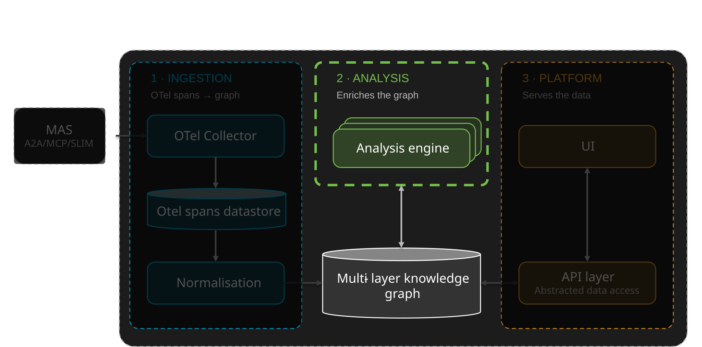

# SCOPE — Analysis

Telemetry tells you what a multi-agent system did. SCOPE's analysis tells you
whether it thought well.

Once a session has been normalised into the knowledge graph, the analysis takes over.
It evaluates the session on three questions: was the **quality** of the answer good,
is the system **reliable** across similar queries, and was its reasoning
**performant**. It also looks for the **cognitive failures** that emerge when agents
work together, such as inconsistent terms, fragmented beliefs or contradictory
summaries, none of which show up in latency or error rates.

The result is not a score on the side. Each analysis writes its findings back into
the graph as a new layer: embeddings, metrics, semantic groups, anomaly and
consistency reports, and insights. Everything downstream reads them from there.

Two families of engines do this work:

- **[KG-enrichment engines](#kg-enrichment-engines)** build the knowledge-graph
  layers, as workers on the ingestion pipeline or on a periodic schedule.
- **[Platform Engines (PEs)](#platform-engines-pes)** read those layers, name the
  cognitive failures in them, decide whether to **trigger a Cognition Protocol**, and
  measure how protocols are used.

## What the analysis engines do

The analysis engines:

- **Evaluate** sessions on quality, reliability and performance, with quantitative
  and LLM-judged metrics.
- **Group** sessions semantically and build a topic hierarchy, so that behaviour is
  compared only between sessions expected to behave alike.
- **Detect anomalies** within a group, against a baseline of normal behaviour.
- **Measure consistency**: how alike the sessions in a group are, on their text,
  their execution graph and their metrics.
- **Derive insights** from the graph, rendered from a catalog of templates.
- **Detect cognitive failures** and attribute them to the source event that caused
  them.
- **Trigger Cognition Protocols** in response, and **measure how those protocols
  are used**.

These capabilities run as a [pipeline of standalone workers](#the-analysis-pipeline)
over the knowledge graph. The next section is detailing the evaluation process,
while the other capabilities are described in later sections.

## Agentic Evaluation

Agentic evaluation goes beyond traditional operational metrics. Error rates, cost,
duration and latency describe execution; they say nothing about whether an answer
was grounded in real data, whether instructions were followed, or whether the
reasoning that produced it was sound.

There are three ways to evaluate an agentic conversation, and SCOPE supports all
three:

| Method | When it applies |
|---|---|
| **Ground-truth comparison** | A user-provided expected answer exists and is comparable |
| **Application-specific heuristics** | A domain-specific answer can be validated by rule |
| **LLM-as-a-Judge** | Neither of the above applies, which is the common case |

### Three dimensions of agentic evaluation

Evaluation is organised into three dimensions. Each is answerable on its own, and
semantic analysis strengthens each of them.

| Dimension | The question it answers | Base method | What semantic analysis adds |
|---|---|---|---|
| **Quality** | Was the answer correct, grounded, relevant and on-task? | Ground-truth comparison, heuristics, LLM-as-a-Judge | A metric dependency tree, so expensive judgements run only where cheaper ones leave doubt |
| **Reliability** | Does the system behave consistently on similar queries? | Active probing | Semantic grouping and consistency analysis |
| **Performance** | Was the reasoning process optimal? | LLM-as-a-Judge, cost | Semantic trajectory analysis |

!!! note "Why the dimensions need semantic analysis"
    Agentic applications are stochastic: the same question can produce different
    outcomes. Judging a single session in isolation cannot distinguish acceptable
    variation from a failure. Semantic analysis supplies the comparison set by
    identifying which sessions are **expected to behave similarly**.

### Reliability

Reliability is the degree of variability within a session's semantic group. It is
measured on three axes rather than one, because they diverge:

- variance of scores,
- dispersion of responses,
- graph edit distance across execution graphs.

A session can be reliable on accuracy, moderately reliable on its execution graph,
and unreliable on its textual response. Reporting a single reliability number would
conceal that.

### Performance

Performance assesses the **optimality of the reasoning process** rather than the
answer: identifying failures, reasoning loops and suboptimal trajectories by
comparing a session's execution path against others in its group.

### Cost control

LLM-as-a-Judge metrics are expensive, so two mechanisms keep evaluation affordable:

- **Metric hierarchies** — metrics are arranged in a dependency tree, so a
  downstream judgement is computed only when the metric above it leaves the
  question open.
- **Stateful and trajectory evaluation** — intent, groundedness and relevance are
  carried as trajectory state across steps rather than recomputed at each one.

## The analysis pipeline

The analysis is not one big monolithic program but rather a modular **pipeline of standalone workers**,
leveraging the different analysis engines.
Each of them reads from the knowledge graph and contributes back to it on the different layers.
Workers can run in two ways: most are chained and run once per session,
but they could also be triggered periodically.

### The per-session chain

The chained workers are connected by RabbitMQ queues: each worker reads from
its input queue, and writes to its output queue, which is
the next worker's input queue.
The chain runs **once per completed session**,
triggered by a session-completion notification, starting from the normalised session
that ingestion has just written.

!!! warning "Partial-session analysis is not supported yet"
    The protocol trigger loop needs signal while a session is still running. The
    pipeline as it stands runs on completion; closing that gap is IoC-side
    integration work, not a property to rely on today.

### Periodic workers

Rather than being triggered at every new sessions, workers could be triggered periodically,
on their own schedule.
The way the periodic workers operate is the same: they read from the knowledge graph
and write back to it.
Periodic workers can also trigger other workers if need be, by writing to their input queues.

### Extensible by design

New analysis engines can be added by subscribing a new worker to a queue, exisiting or new, without
modifying the ones that already run.

## KG-enrichment engines

The KG-enrichment engines are the workers of the pipeline above. Each one reads the
knowledge graph and contributes a layer to it.

| Worker | When | What it does |
|---|---|---|
| **embedding** | Ingestion | An embedded vector for each state in the trajectory |
| **mce** | Ingestion | The configured metric set for the session — quantitative and LLM-judged |
| **grouping** | Ingestion | Assigns the session to a semantic group, using the embeddings |
| **analysis** | Ingestion | A bundle of three analyses run together over the assigned group — **anomaly detection** (outlier sessions within the group), **consistency** (how alike the sessions in the group are, on text, execution graph and metrics) and **normal behaviour** (the baseline anomaly detection scores against). Reached only if grouping could assign the session to a group |
| **stateful-eval** | Ingestion | Temporal and stateful metric computation over the trajectory |
| **hierarchical grouping** | Periodic | Builds and rearranges the semantic-group hierarchy as sessions arrive |
| **intelligence** | Periodic | Derives insights from the KG from a catalog's templates |

`mce` and `stateful-eval` are also the evaluation surface that
MAS-Lab uses to measure the Cognition Protocols.

!!! note "Semantic grouping is a prerequisite, not a feature"
    Normal behaviour cannot be defined for a multi-agent system in general, only
    within a set of sessions expected to behave alike. Grouping therefore has to
    run before anomaly detection, reliability and wasted-resource analysis can mean
    anything. It also produces a **topic hierarchy**, which is what makes a question
    such as *how is the travel agent behaving on refund requests* answerable by
    filtering rather than by search.

## Platform Engines (PEs)

**PEs are where the analysis meets the Cognition Protocols.** They read the layers the
pipeline has written to the knowledge graph and use them in two ways: one engine
decides **when a protocol should run**, the other measures **what a protocol did**
once it has.

### Cognitive failures in multi-agent systems

Multi-agent cognitive failures originate in breakdowns that infrastructure
monitoring cannot see. Once agents coordinate, the environment in which cognition
takes place is transformed: agents adopt inconsistent abstractions or naming
conventions, beliefs fragment across asymmetric evidence, and summaries become
contradictory.

These semantic and epistemic divergences propagate into failures of coordination
and collective reasoning — misaligned plans, incomplete reasoning chains — that
are **invisible to latency or throughput metrics** and emerge from interactional
dynamics distributed across the team.

Grounded in distributed cognition and shared mental models, the failures organise
along two axes:

- the **cognitive function** whose breakdown produces the failure;
- the **locus** at which it becomes observable.

That **Locus × Function** taxonomy is the foundation for what the analysis engines detect
and surface.

### Cognitive failure detection and trigger

This engine is the sensing side of the Core loop. It turns the analysis into a
stream of cognitive signals and acts on them:

- **Detects** the cognitive failures in a session, each named by its **function** and
  **locus**
  and attributed to the exact source event that caused it.
- **Triggers** the matching Cognition Protocol, so that the agents re-open alignment
  while the session is still running.
- **Writes** its findings back into the knowledge graph, where the UI and later
  analyses read them.

!!! warning "Triggering is under development"
    Triggering a Cognition Protocol from a live session is not yet shipped. For now,
    the results of past sessions are used to establish the rules that will decide
    when a protocol should be triggered.

### Protocol usage measurement

This engine looks at a whole session, to see what the Cognition Protocols
did in it:

- **Detects** in the session when a Cognition Protocol was **activated**.
- **Computes metrics** on its usage, so that the effect of a protocol on a session
  can be measured rather than assumed.

These results are surfaced in the UI's Cognition Protocols tab for the session. The engine is
implemented by the [cognition protocols worker](workers/cognition-protocols-worker.md).

## In this section

- **[Pipelines](pipelines.md)** — how the workers are chained by queues: the per-session ingestion pipeline, the periodic operations, and how to add a worker.
- **[Workers](workers/index.md)** — one page per worker: [embedding](workers/embedding-worker.md), [MCE](workers/mce-worker.md), [grouping](workers/grouping-worker.md), [hierarchical grouping](workers/hierarchical-grouping-worker.md), [analysis](workers/analysis-worker.md) ([anomaly detection](workers/anomaly-detection-worker.md), [consistency](workers/consistency-worker.md), [normal behaviour](workers/normal-behaviour-worker.md)), [stateful eval](workers/stateful-eval-worker.md), [intelligence](workers/intelligence-worker.md), [cognitive failure](workers/cognitive-failure-worker.md) and [cognition protocols](workers/cognition-protocols-worker.md). The [norm worker](../ingestion/normalization/norm-worker.md) is documented with normalization.
- **[Components](components/index.md)** — the libraries behind the workers: the [analysis toolkit](components/analysis.md), the [Metrics Computation Engine](components/mce.md), [stateful evals](components/stateful-evals.md), the [intelligence catalog](components/intelligence-catalog.md) and [worker base](components/worker-base.md).
