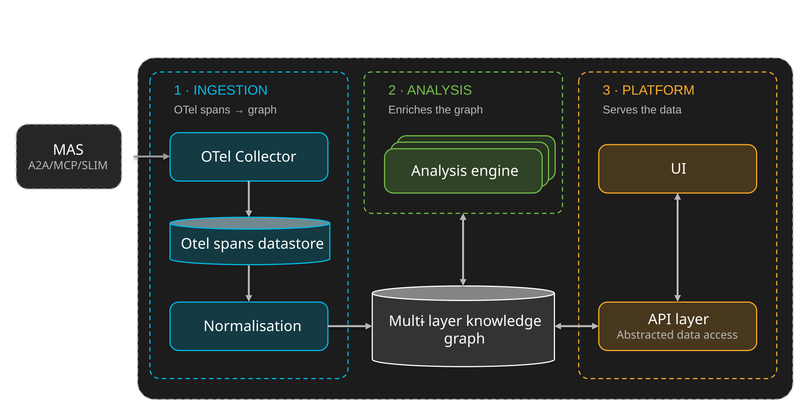

# System for Cognitive Observability Provenance and Explainability (SCOPE)

The comprehension layer for the Internet of Cognition

**SCOPE is a modular platform for observing, analysing and explaining multi-agent
system executions from OpenTelemetry traces.** It ingests raw OTel spans,
maps them onto a shared MAS ontology, and enriches each session with semantic grouping,
anomaly detection, consistency checking and stateful trajectory
evaluation. It also enriches each session with **cognitive observability**, used to detect cognitive failures within a session.
All of this is surfaced through an API and a web dashboard.

Its objective is to turn multi-agent telemetry into explainable, actionable and
controllable operations at enterprise scale. That decomposes into three functions:

| | Function |
|---|---|
| **1. Observe** | Reconstruct what the multi-agent system actually did, across agents, tools, memory and workflows |
| **2. Explain** | Turn telemetry into analysis, anomaly detection and trajectory intelligence, with a clear account of what to fix, optimise or watch next |
| **3. Recommend** | Turn that account into actionable remediation, so agentic systems can run safely and reliably in production |

## How SCOPE works

SCOPE turns raw OTel spans into curated insights. A central **knowledge graph** sits
at its core: every stage writes into it, and every consumer reads from it. A session
moves through three stages, each covered in more detail on its own page.

| Stage | What happens | Details |
|---|---|---|
| **1. Ingest** | A MAS emits OTel spans to an OTel collector, which stores them in a span datastore. The ingestion pipeline normalises each session into the knowledge graph, following the MAS ontology | [Ingestion](ingestion/index.md) |
| **2. Enrich** | The analysis engines add layers to the graph: embeddings, metrics, semantic groups, anomaly and consistency reports, and insights | [Analysis](analysis/index.md) |
| **3. Serve** | The enriched graph is served through the API and visualised in the UI, and read by Cognition Engines through the fabric | [Platform](platform/index.md) |

The ingestion and enrichment run as a chain of workers connected by queues, once per
session, alongside two periodic workers that maintain the semantic-group hierarchy
and derive insights. The modular worker chain is described in
[Analysis](analysis/index.md#the-analysis-pipeline).

### Extensible by design

The pipeline is modular, so a new analysis is added without touching what already
runs. Every worker is:

- **A separate package** — its own build, CLI entry point and container image, so
  shipping or rolling back one worker never touches the others.
- **A queue consumer and producer, not a caller** — it knows the names of the
  queues it reads from and writes to, and holds no reference to the workers
  upstream or downstream of it.
- **Runnable two ways** — long-running queue mode in production, or single-message
  mode for local testing and workflow steps.

Adding a stage means writing a worker that subscribes to an existing output queue
and publishes its own results. No existing worker is modified.

## The knowledge graph

### Why OpenTelemetry alone is not enough

OpenTelemetry is optimised for collection and storage, not for reasoning about a
multi-agent execution. Raw spans arrive with four properties that make them
unusable as an analysis substrate:

| Property | What it means |
|---|---|
| **Heterogeneous** | Different frameworks and SDKs describe the same construct differently |
| **Incomplete** | The relationships that constitute collective behaviour are not recorded by any single agent |
| **Not queryable** | There is no structure to ask questions of beyond the span tree |
| **Inconsistent** | The same field carries different meanings across emitters |

Semantic conventions improve this only partially. Three gaps remain — **structure**,
**temporal** and **semantic** — and closing them is the purpose of the knowledge
graph: normalisation turns spans into a structured model, and later stages enrich it.

### A layered graph, defined by the ontology

The graph is layered, and **every stage writes its own layer** — which is what makes
the analysis composable: a later stage reads the layer an earlier one produced rather
than re-deriving it from raw spans. Each layer is defined by one of five bundled
ontologies, which share a single namespace.

| Layer / ontology | Written by | Holds |
|---|---|---|
| **MAS** | norm | The core execution schema — structural types (MAS, Agent, LLM, Tool, Processing), their execution instances, and the normalised State/Transition trajectory under a single session identity |
| **Semantic** | embedding, grouping, hierarchical grouping | The embedding layer linking State and Execution nodes to embeddings, and the semantic groups that gather sessions |
| **Metrics** | mce | The Metric/MetricResult definition–observation split, score nodes, templates |
| **Analysis** | analysis, cognitive failure, cognition protocols | Analysis reports — consistency, anomaly and normal behaviour of a group of sessions, and the cognitive failures and Cognition protocols of a session |
| **Insight** | intelligence | Rendered, catalog-templated insights attached to a target graph node |

The ontology is published, along with documentation and visualisation, at
[ioc-project.github.io/scope/ontologies.html](https://ioc-project.github.io/scope/ontologies.html).

## Positioning

Within IoC, SCOPE sits **inside the Cognition Fabric** and supplies its comprehension
layer. The fabric owns the runtime and the contracts, and SCOPE owns the ingestion and
analysis that populate them.

| Concern | Owner |
|---|---|
| Ingestion, normalisation, the graph, enrichment, insight production | **SCOPE** |
| Fabric runtime, the three-tier API surface, CE routing and chaining, the protocol interaction plane | **CF** |
| The **Cognition Store** — publish / retrieve-notify, CE findings | **CF** |

The **Cognition Engines** do not read SCOPE directly. They bind the CF API tiers, and
the fabric serves SCOPE's output — insights, trajectories and metrics — through
them. The **Analytics CF API**, the read-only tier they consume, is served through
SCOPE's API layer.

SCOPE can also be **deployed standalone**, independently of the rest of IoC. It has
its own repository, lifecycle and release cadence, and operates against any MAS
emitting OpenTelemetry traces without requiring the Cognition Fabric, the Cognition
Protocols or any other IoC component.

[:octicons-arrow-right-24: Deploy SCOPE standalone](tutorials/deploy-scope.md)

## Explore SCOPE

-   **[Ingestion](ingestion/index.md)** — what a MAS must emit, how spans reach SCOPE, and how they become a normalised session in the knowledge graph.
-   **[Analysis](analysis/index.md)** — everything that enriches the knowledge graph, and the Platform Engines it feeds.
-   **[Platform](platform/index.md)** — the API and UI that serve and visualise the knowledge graph, the datastores behind them, and deployment.
-   **[Getting Started](tutorials/index.md)** — instrumenting a system and reading what SCOPE produces.

## Source material

- [`ioc-project/scope`](https://github.com/ioc-project/scope) — SCOPE repo, under Apache 2.0 license.
- [Ontology documentation](https://ioc-project.github.io/scope/ontologies.html)
- [AGNTCY Observe SDK](https://github.com/agntcy/observe) — the reference instrumentation
