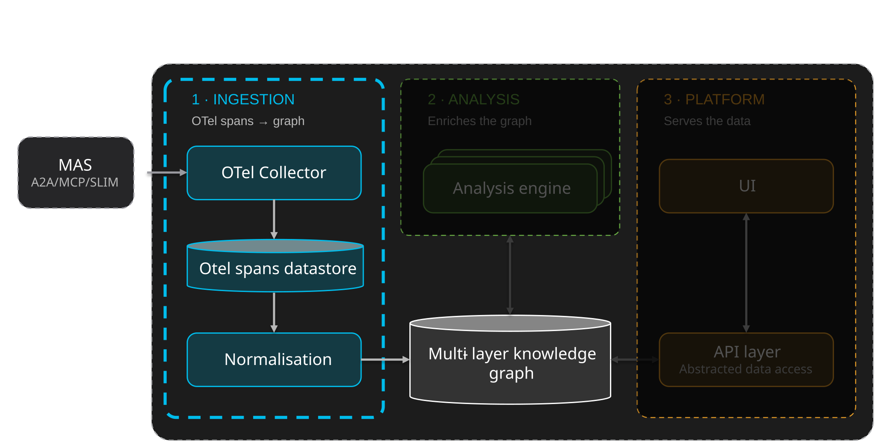

# SCOPE — Ingestion

From OTel spans to a normalised execution model

SCOPE expects OpenTelemetry spans from the MAS. An OTel collector receives and stores them,
and the ingestion pipeline turns them into a normalised MAS model in the knowledge graph.

## The telemetry path

1. The **MAS emits OTel spans**, through whichever instrumentation it uses.
2. An **OTel collector** receives them over OTLP/HTTP.
3. The collector exports them to a **span datastore**.
4. The **ingestion pipeline** reads the spans from the datastore and builds the
   normalised execution model from them.

**SCOPE offers a default collector and datastore, but neither is mandatory.** The
deployment includes an OTel collector and a ClickHouse instance, so a MAS can simply
point its exporter at the collector. Both are replaceable: any OTel collector that
can forward the spans, and any datastore the ingestion pipeline can read from, can
take their place without changing the rest of the platform.

!!! note "Nothing is installed in the agent application"
    SCOPE itself is not installed alongside the agents. The application is
    instrumented to emit OpenTelemetry, and the spans are collected and stored
    outside it.

## Instrumentation

**SCOPE requires OpenTelemetry, not a specific SDK.** Any MAS that emits
semantic-convention-compliant spans can be ingested, whatever produces them:

- **AGNTCY Observe SDK** — the reference instrumentation. The `ioa_observe_sdk`
  package decorates agent, tool and workflow functions and emits spans to an
  OTLP/HTTP collector.
- **[Insight module for agentic systems](https://github.com/outshift-open/insight-module-for-agentic-systems/)**
  — an OpenTelemetry plugin for OpenClaw-style systems, and the alternative to the
  Observe SDK when the MAS is not an application you instrument with decorators.
  Its telemetry is supported out of the box.
- **Other emitters** — vendor SDKs, framework auto-instrumentation and custom
  emitters are all admissible, as are the boundary-level traces propagated in
  black-box mode.

[Instrument an agent manually or with a coding harness](../tutorials/instrument-your-app.md){ .md-button }

!!! warning "Fidelity tracks instrumentation richness"
    Fields that are not convention-compliant are inferred on a best-effort basis,
    and black-box traces arrive with materially less semantic content than
    SDK-instrumented ones. Analysis coverage is therefore wider where
    instrumentation is richer. What does **not** vary is the ingestion contract.

## Ingestion

Ingestion **normalises the raw OTel spans into a MAS model, stored in the knowledge
graph (KG) and structured by the [MAS ontology](#the-mas-ontology)**. The ingestion
pipeline, a chain of workers, reads the spans from the datastore once they are
there; its first worker, normalisation, builds that model.

!!! note "Two modes of span ingestion"
    The ingestion pipeline, and more precisely the normalisation worker, supports two modes.
    Spans can either be ingested when a **session-completion notification** is received; or
    spans are ingested as they arrive in a near real-time fashion, providing real-time support
    for the knowledge graph.

!!! warning "Partial-session analysis is not shipped"
    The protocol trigger loop needs signal while a session is still running. The
    pipeline as it stands runs on completion; closing that gap is IoC-side
    integration work, not a property to rely on today.

### The MAS ontology

Raw spans describe calls, not systems: the same agent or tool call is described
differently by each SDK, and nothing in the span tree says what an agent *is* or how
one step led to the next. The **MAS ontology** supplies that missing structure. It is
the schema the knowledge graph follows, and normalisation is the act of expressing a
session's spans in its terms.

It works at three levels:

- **Structure** — the types that describe a MAS: the MAS itself, its Agents, LLMs,
  Tools and Processing steps. These are the stable parts of the system.
- **Execution** — instances of those types, one per time they ran in a session.
  Each execution node points back at the structural type it is an instance of.
- **Trajectory** — the executions of a session, ordered as a chain of **State** and
  **Transition** nodes under a single session identity. This is the reconstructed
  path the MAS took, which later analysis reads instead of the span tree.

Because every source is mapped onto the same types, a trace from one framework and a
trace from another become comparable, and a worker never needs to know which
instrumentation produced a session.

The MAS ontology is the core of five bundled ontologies that share one namespace.
The other four — Metrics, Semantic, Analysis and Insight — are not written by
normalisation: each is a layer that a later worker adds on top of the normalised
trace, linking back to its State and Execution nodes. That is what makes the
analysis composable.

[:octicons-arrow-right-24: The five ontologies and the graph layers they form](../index.md#the-knowledge-graph)

[:octicons-arrow-right-24: The pipeline in detail](../analysis/index.md#the-analysis-pipeline)

[:octicons-arrow-right-24: The API, UI and datastores](../platform/index.md)

## Dive deeper

-   **[Normalization](normalization/index.md)**

    ---

    How the normalisation worker turns the raw spans of a session into the MAS model in the
    knowledge graph: what it reads, how it dispatches each span, and the post-processing passes.

    - [Normalization pipeline](normalization/normalization.md)
    - [User guide](normalization/user-guide.md)
    - [Developer guide](normalization/developer-guide.md)
    - [Code structure](normalization/code-structure.md)
    - [Norm worker](normalization/norm-worker.md)

-   **[The ontology](ontology/index.md)**

    ---

    The schema the knowledge graph follows: five ontologies sharing one namespace, and the
    SHACL shapes that verify what normalisation produces. Each ontology has its own page,
    linking to its Widoco reference documentation.

    - [MAS](ontology/mas.md)
    - [Semantic](ontology/semantic.md)
    - [Metrics](ontology/metrics.md)
    - [Analysis](ontology/analysis.md)
    - [Insight](ontology/insight.md)

## Source material

- [AGNTCY Observe SDK](https://github.com/agntcy/observe) — the reference instrumentation
- [Insight module for agentic systems](https://github.com/outshift-open/insight-module-for-agentic-systems/)
- [`ioc-project/scope`](https://github.com/ioc-project/scope) — SCOPE repo, under Apache 2.0 license
- [Instrumenting a MAS: tutorial](../tutorials/instrument-your-app.md)
- [Instrumenting an OpenClaw-style MAS: tutorial](tutorials/instrument-openclaw.md)
