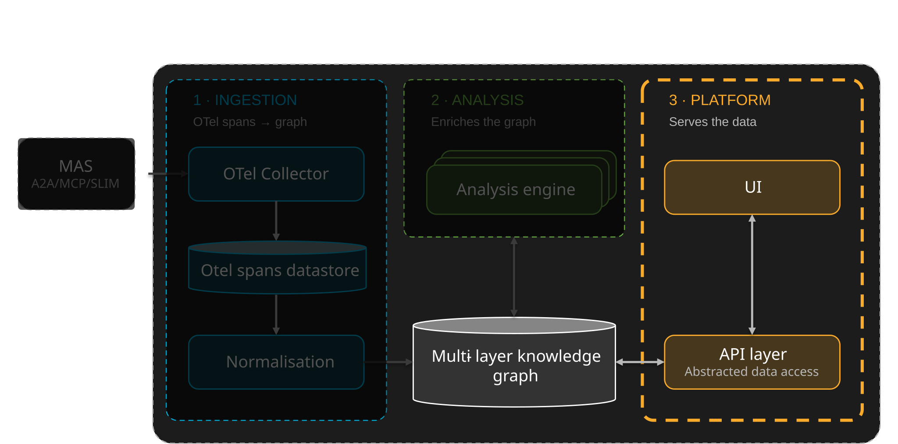

# SCOPE — Platform

The platform serves and visualises the data held in the knowledge graph: the **API**
that exposes it to consumers, and the **UI** that lets people explore it. This page
also covers how SCOPE is deployed and the datastores behind it.

## API layer

The API layer sits in front of the knowledge graph and is **SCOPE's stable contract**.
Every consumer reads SCOPE's output through it rather than querying the databases
directly, which is the reason a backend can be swapped without upstream clients
noticing.

### What it serves

The API exposes the knowledge graph as three kinds of resource, each read from the
layers the analysis workers write:

| Resource | What it is | Comes from |
|---|---|---|
| **Insights** | Curated findings, rendered from the intelligence catalog and attached to the graph node they concern | The Insight layer |
| **Trajectories** | The reconstructed multi-hop execution of a session: its states and transitions, under a single session identity | The MAS layer, written at normalisation |
| **Metrics** | Derived quantities: the metrics computed for a session, their scores, and the reports built on them | The Metrics and Analysis layers |

### Who consumes it

- **The UI** reads the API to visualise sessions, trajectories, groups, metrics and
  insights.
- **Cognition Engines** reach it through the Cognition Fabric. The API backs the
  **Analytics CF API**, the read-only tier of the fabric's three-tier API surface,
  so engines never read SCOPE directly. Two clients sit on the CF side of it: a
  **management-plane client** for configuration and lifecycle, and an
  **SCOPE / shared-memory client** that reads insight and context.
- **Any other client** when SCOPE is deployed standalone, without the fabric.

## Datastores

Two datastores sit behind the API layer. They are **implementation, not
architecture**: because consumers only ever see the API, either backend can be
replaced without changing what they see. The backends below are the current choices,
not requirements.

| Store | Role | Current backend |
|---|---|---|
| **Raw telemetry** | Landing zone for the spans exactly as received, before any interpretation | ClickHouse |
| **Knowledge graph** | The normalised MAS execution model and everything layered on it: embeddings, metrics, reports and insights. It is the object analysis runs on, and the one the API serves | Neo4j |

The knowledge graph is the store consumers care about; the raw telemetry store is an
intermediate one, and does not need to be exposed to them.

[:octicons-arrow-right-24: How the graph is structured](../index.md#the-knowledge-graph)

## UI

The web UI is a dashboard for observing and analysing multi-agent systems. It is a
React single-page application that reads everything from SCOPE's REST API, and it
is served as static files by nginx, which proxies its API calls to the backend.

### How it is organised

The UI is organised around **applications**, each being a MAS whose sessions SCOPE
has ingested. An application page has four tabs:

| Tab | What it shows |
|---|---|
| **Overview** | The application's make-up: its agents, LLMs and tools, and its completed and live sessions |
| **Explain** | The analysis of how the application behaves, across sessions — see below |
| **Monitor** | Metrics over time, at the application level and per agent |
| **Inspect** | The sessions themselves: completed sessions, and live sessions with their topology |

### Explain

The Explain tab turns the analysis layers of the knowledge graph into views, in two
groups.

- **Agent behaviour** — what the agents are working on (semantic groups and the
  topic hierarchy), how they are reasoning, and what resources they are using.
- **Performance** — how they are failing, plus the cognitive observability and
  Cognition Protocol (L9) views.

### Inspecting a session

Selecting a session opens its detail view, which is where the reconstructed
trajectory is read:

| Tab | What it shows |
|---|---|
| **Overview** | Cost, tokens and duration |
| **Analysis** | The session's metrics and analysis results |
| **Cognitive Observability** | The cognitive failures detected in the session |
| **L9 Protocols** | The Cognition Protocols that ran in the session |
| **Reasoning Path** | The path of reasoning the agents followed |
| **Execution Graph** | The execution structure of the session |
| **Conversation** | The exchange between the agents |

### Feature flags

Optional views are gated by feature flags, because they depend on optional workers
or services in the deployment. Semantic groups, insights, live topology and stateful
evaluation are on by default. Impact assessment, waste estimation, neurosymbolic
evaluation, cognitive observability and the L9 protocols views are off by default,
and are switched on per deployment, without rebuilding the image.

## Deployment posture

!!! info "The adoption path"
    SCOPE does not have to be deployed as a stack of its own. Because it is agnostic
    to the databases behind the graph and the telemetry store, it can in future
    integrate with the observability platform a customer **already runs**, and
    contribute the cognitive layer on top of it.

### How it is deployed

| Target | How |
|---|---|
| **Kubernetes** | Helm charts covering the API, UI, workers and supporting infrastructure |
| **Local, full stack** | Docker Compose — OTel collector, ClickHouse, RabbitMQ, Neo4j, the workers, the API and the UI together. See [Deploy SCOPE](../tutorials/deploy-scope.md) |

## In this section

- **[API](api/index.md)**: the unified DB access layer and REST API: its architecture, the interactive Swagger reference, using it as a library, and its tests.
    - [Run the API standalone](api/standalone.md): what it needs, its `.env` file, and running it from source or in a container.
- **[UI](ui/index.md)**: the React dashboard: a tour of what it shows, which views depend on which workers, and how it is built.
    - [Run the UI standalone](ui/standalone.md): its `.env` file, and running it as a dev server or a container, against any API.
