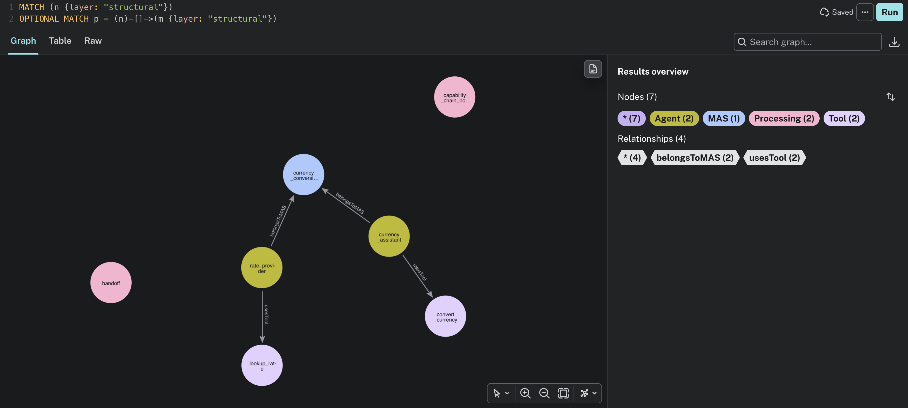
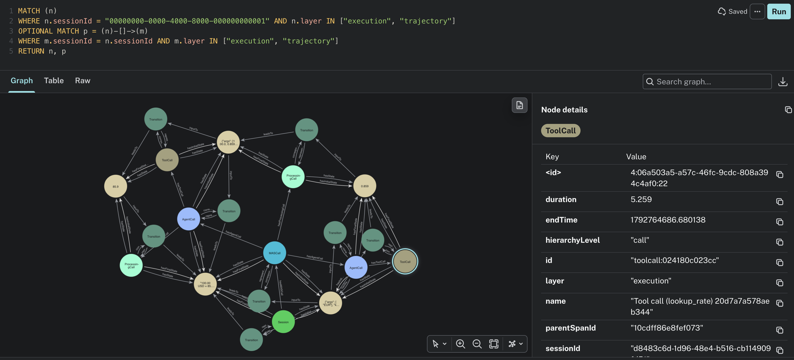
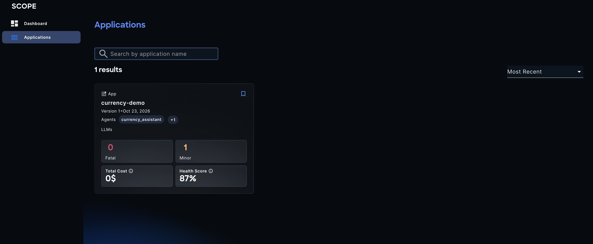
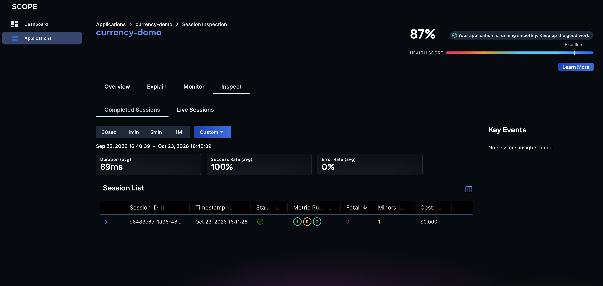
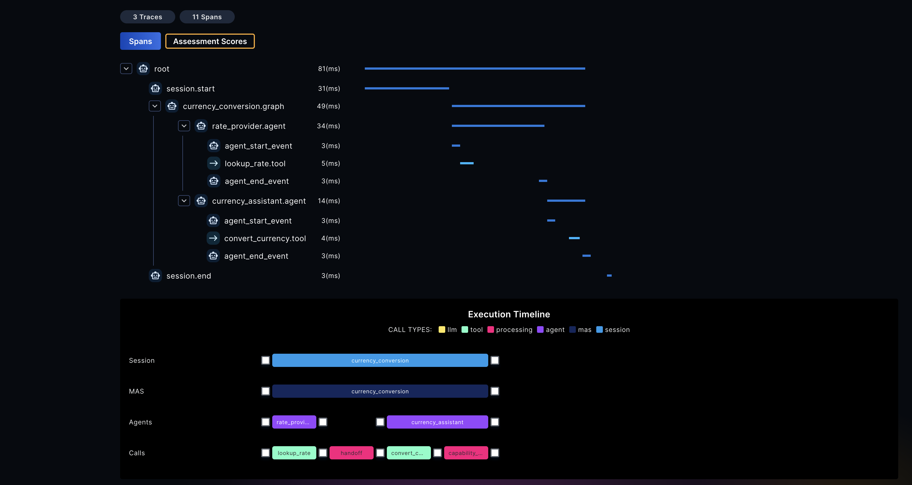

# SCOPE — Tutorial: Ingesting your first trace

<p class="eyebrow">From <code>docker compose up</code> to one session in the knowledge graph and in the dashboard</p>

## Before starting

This walkthrough runs the whole SCOPE stack on your machine, sends it the trace of a small
two-agent application, and follows that trace to the places where you can look at it: the
knowledge graph in Neo4j and the SCOPE dashboard. It takes about 15 minutes, most of it the first
image build.

You need:

- Docker with the Compose plugin (v2.17 or later) and at least **12 GB of memory** given to Docker.
- A checkout of this repository.
- [`uv`](https://docs.astral.sh/uv/), to run the example application.
- An OpenAI-compatible LLM endpoint and key. Without one, spans are still collected and
  normalised into the knowledge graph, so this walkthrough works, but the analyses that call a
  model do not run.


## 1. Start the SCOPE stack

```bash
cd deploy/docker-compose
cp .env.template .env
```

Edit `.env`: set `LLM_MODEL_NAME`, `EMBEDDING_MODEL_NAME`, `LLM_GATEWAY_BASE_URL` and
`LLM_GATEWAY_API_KEY`, and replace the `change-me` passwords. Then build and start everything:

```bash
docker compose up -d --build
```

The first build takes a while. When it returns, check the services:

```bash
docker compose ps
```

All services should be `running` (and `healthy` where there is a healthcheck). `clickhouse-setup`
is a one-shot job and shows `exited (0)`.

These are the addresses used in the rest of the walkthrough:

| What | Where |
|---|---|
| Dashboard and API | <http://localhost:8080> |
| OTLP/HTTP collector, where the application sends its spans | `http://localhost:4318` |
| Neo4j browser, the knowledge graph | <http://localhost:7474> |
| RabbitMQ management | <http://localhost:15672> |

## 2. Send one trace

The example MAS we'll be using is a simple currency conversion app made up of two agents: a `rate_provider` looks up the exchange
rate and hands over to a `currency_assistant`, which converts the amount. It calls no model, so
it needs no key. Each run is one **session**: a single, independent execution that SCOPE
reconstructs from its spans.

Open [`examples/currency-demo/main.py`](https://github.com/ioc-project/scope/blob/main/examples/currency-demo/main.py)
to see how it is instrumented with the AGNTCY Observe SDK: `@agent` for each agent, `@tool` for
each tool, `@graph` for the workflow, and one `session_start()` around the request. The
[Instrument your app](instrument-your-app.md) tutorial explains each piece.

In another terminal, from the repository root:

```bash
cd examples/currency-demo
export OTLP_HTTP_ENDPOINT=http://localhost:4318
uv run main.py 100
```

```text
100.00 USD = 85.90 EUR (example rate)
```

## 3. Follow the trace through the pipeline

The spans go through four steps. Each one is visible in the logs of the stack, from
`deploy/docker-compose`:

1. The **collector** receives the spans and stores them in ClickHouse.
2. When the `session.end` span arrives, the **session-end trigger** publishes the session to
   RabbitMQ. It logs nothing when it does: its log only shows that it is polling
   (`Polling default.otel_traces for session.end every 3s`), and a `404 Not Found` line or two
   at startup is normal, it is waiting for the norm worker's queue to exist.

3. The **norm worker** receives the session, fetches its spans, maps them onto the
   [SCOPE ontology](../ingestion/index.md) and writes the session to the knowledge graph. This is
   where you find the session id:

    ```bash
    docker compose logs norm | grep session_id
    ```

    ```text
    Fetched 11 spans for session_id=00000000-0000-4000-8000-000000000001
    Completed processing for session_id: 00000000-0000-4000-8000-000000000001
    ```

    Note the session id, you will look for it below. If nothing shows up after a minute, check that
    the spans arrived: `docker compose logs otel-collector | tail`.

4. The **embedding worker** takes over, and the analysis workers (metrics, grouping,
   stateful evaluation, cognitive failures) run on the session.

The session appears in the graph within a few seconds. The analyses take longer, depending on
your model.

## 4. See the session in the knowledge graph

Open the Neo4j browser at <http://localhost:7474> and connect with:

| Field | Value |
|---|---|
| Connect URL | `bolt://localhost:7687` |
| Username | `neo4j` |
| Password | the `NEO4J_PASSWORD` from your `.env` |

List the sessions:

```cypher
MATCH (s:Session) RETURN s
```

The nodes that describe the system and its executions carry a `layer` property saying what they are: `structural` for the
multi-agent system itself, `execution` for a session and its calls, and `trajectory` for the states
and transitions between them. Look at the first and then at the other two.

**The topology** is the `structural` layer: the multi-agent system as types. It holds the MAS, its
agents, the tools they use and the processing steps, not any single run. It is shared by all the
sessions of the application:

```cypher
MATCH (n {layer: "structural"})
OPTIONAL MATCH p = (n)-[]->(m {layer: "structural"})
RETURN n, p
```



For the example, you see the `currency_conversion` MAS (named after the `@graph`), its two agents
(`rate_provider` and `currency_assistant`) each tied to it by `belongsToMAS`, and the tool each one
uses by `usesTool`: `lookup_rate` and `convert_currency`. The two `Processing` nodes, `handoff` and
`capability_chain_boundary`, are not in your code: SCOPE derives them from the trace. Click a node
to see the `description` you gave it in the decorator.

**The execution** is what happened in one session: the instances. Use the id you noted above. The
query returns the session, its calls (the multi-agent call, one **agent call** per agent, and the
**tool calls**), and the **states** and **transitions** that link them:

```cypher
MATCH (n)
WHERE n.sessionId = "<your session id>" AND n.layer IN ["execution", "trajectory"]
OPTIONAL MATCH p = (n)-[]->(m)
WHERE m.sessionId = n.sessionId AND m.layer IN ["execution", "trajectory"]
RETURN n, p
```



Every call points to the transition it corresponds to, and to the state it started from
(`hasInitialState`) and the state it ended in (`hasFinalState`). Replace `["execution", "trajectory"]`
with `["execution"]` in both places to keep only the session and its calls, without the states and
transitions.

Click a node to read its properties: the agent or tool name, its duration, whether it succeeded and
the text that went in and out. The node and relationship types are defined by the
[ontology](../ingestion/index.md).

## 5. See the session in the dashboard

Open <http://localhost:8080>. The dashboard reads the same knowledge graph through the API.

1. Open **Applications**. The application is named after the service the example registered,
   `currency-demo`.

    

2. Open the application and go to **Inspect**. Your session is listed with its cost and
   metrics computed so far.

    

3. Click on the session. The execution graph shows the two agents and the tools they called, in the
   order they ran, and the details panel shows each step's input and output. This is the same
   structure you saw in Neo4j.

    

## 6. Send more and clean up

Run the example a few times with different amounts to give SCOPE more sessions to compare:

```bash
uv run main.py 250
uv run main.py 40
```

When you are done, from `deploy/docker-compose`:

```bash
docker compose down        # stop the stack and keep the data
docker compose down -v     # stop it and delete the data volumes
```

## Where to go next

- [Instrument your own application](instrument-your-app.md), manually or with a coding assistant.
- [Deploy SCOPE](deploy-scope.md) on Kubernetes with the Helm chart.
- [How the analysis works](../analysis/index.md).
