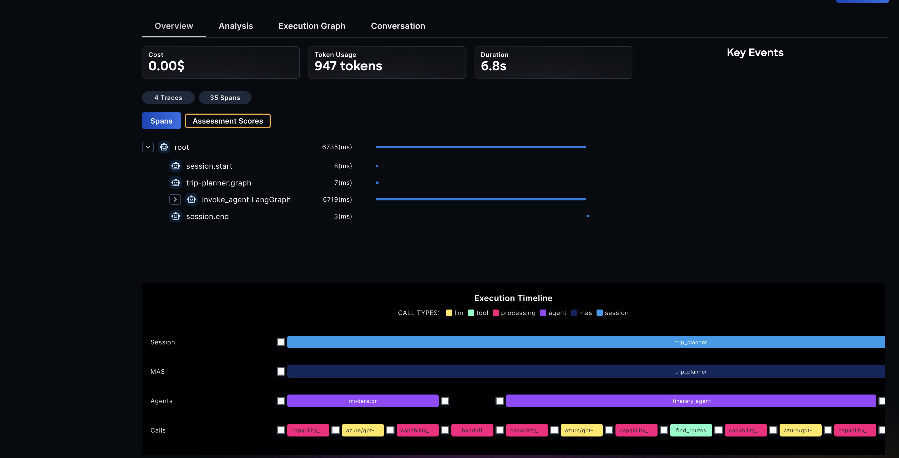
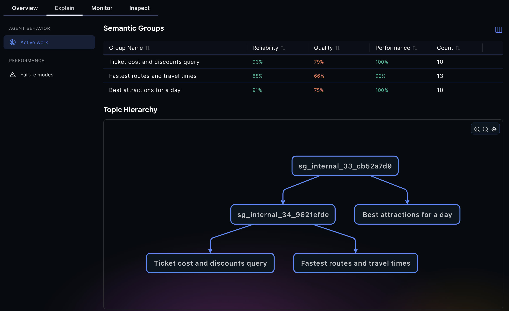
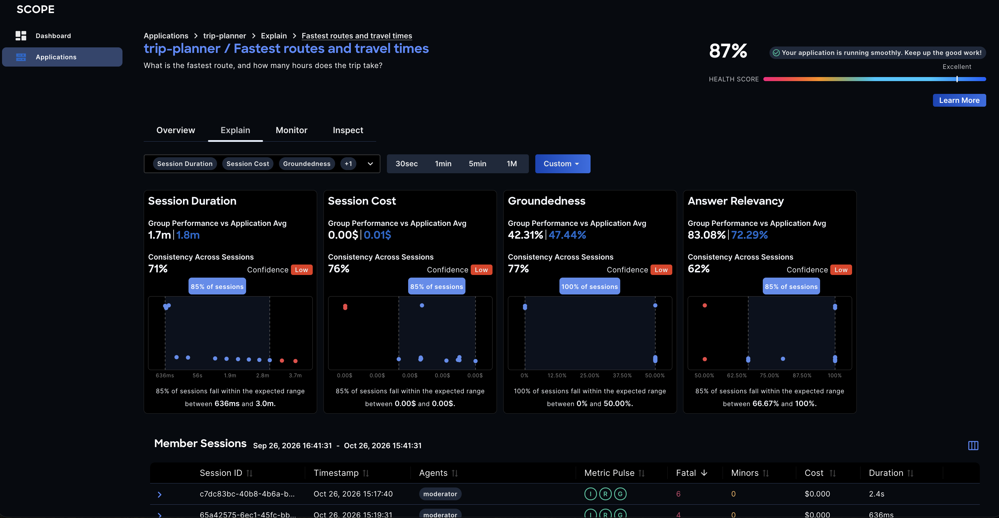
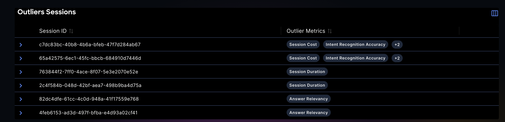
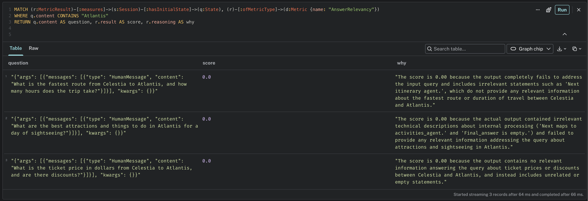

# SCOPE — Tutorial: Semantic analysis

<p class="eyebrow">Evaluate a multi-agent system without a ground truth, by comparing each session with its peers</p>

## The problem: judging natural language without an answer key

A multi-agent system is observed through its traces, and a trace tells you what the system *did*: which agents ran, which
tools they called, how long it took and what it cost. It does not tell you whether the answer was any good. The answer is
natural language, and natural language cannot be scored by the metrics of traditional monitoring: there is no
status code for "the itinerary was wrong", and an exact-match test fails on two correct answers worded differently.

The usual answer is an **LLM as a judge**: another model reads the question and the answer and scores them (relevancy,
completeness, task completion, groundedness...). It works, but it has two limits that matter in production:

- **It is expensive.** Every judged metric is a model call, for every session.
- **A score alone says little.** Is a task completion of 0.7 good? Judges are stochastic, and a system that is
  itself stochastic produces a different answer every time. With no **ground truth**, no expected answer written
  for each question, there is nothing to compare the score to. Nobody writes the expected answer of every question
  that users will ask.

## The idea: compare each session with its peers

If you cannot compare a session with the right answer, compare it with the other sessions that asked for the same
thing. Sessions that ask similar questions, or talk about the same topic, can be **expected to behave alike**: each one
is a reference for the others. SCOPE builds that reference in three steps, each answering a question that a single
trace cannot:

| Step | The question it answers | How | Where you see it |
|---|---|---|---|
| **Semantic grouping** | Which sessions are expected to behave alike? | Each session is embedded from its input, and the sessions whose embeddings are close form a group | **Explain** → **Active work** |
| **Reliability** (consistency) | How much do the sessions of a group differ from each other? | The variability within the group, on three layers: the **metrics** (their spread), the **text** of the answers (the dispersion of their embeddings) and the **execution graph** (the distance between graphs), with a confidence level | *Consistency across sessions* on each metric card |
| **Normal behaviour** | What does a typical session of the group look like? | A central value and a range for each metric, a representative answer, a representative execution graph | *Group performance*, and the expected range of the chart |
| **Anomaly detection** | Which sessions depart from it? | An isolation forest on each layer, within the group | The red points, and the *Outliers Sessions* table |

None of them needs the right answer. A judge score is no longer a grade to read alone, it is a signal that is read
against the group: a task completion of 0.5 is an anomaly in a group where the sessions score 0.95, and ordinary in one
where they score 0.5. The same comparison tells you where to spend the expensive evaluation: on the sessions and the
groups that stand out. The [analysis overview](../analysis/index.md) describes the three dimensions that this makes
possible, quality, reliability and performance.

This walkthrough shows each step on a small system, from the first trace to the outlier that the analysis points at.

## The example: a trip planner and a trap

The [trip planner](https://github.com/ioc-project/scope/tree/main/examples/trip-planner) is a LangGraph MAS with a moderator and
three specialist agents that answer questions about three fictional cities. Its questions come in three sets, each
asking for the same thing in close wording:

| Set | Example | Specialist |
|---|---|---|
| Routes | *What is the fastest route from Celestia to Luminos, and how many hours does the trip take?* | `itinerary_agent` |
| Activities | *What are the best attractions and things to do in Celestia for a day of sightseeing?* | `activities_agent` |
| Fares | *What is the ticket price in dollars from Celestia to Verdantia, and are there discounts?* | `concierge_agent` |

Each set has eleven questions. Ten are ordinary. The eleventh is a trap: it asks about **Atlantis**, a city the planner
does not know. It reads like its ten peers, and the system runs through the same steps, but it cannot answer it. That is
a failure that no error rate shows (nothing crashed, the answer is a polite refusal) and that only the content of the
answer reveals. You should end up with three groups, and the Atlantis sessions should stand out in them.

You need:

- A running SCOPE stack, started as in [Your first trace](first-trace.md), with an LLM endpoint configured in `.env`.
  The embeddings, the names of the groups and the judge metrics come from it, so this walkthrough does not work
  without one.
- Python 3 to load the sessions. [`uv`](https://docs.astral.sh/uv/) and a model for the application itself are
  only needed for the first step: the sessions come as a recording.

!!! note "Keeping the cost down"
    Besides the judge metrics of the metrics computation engine (MCE), which the analysis needs, every session goes through two more workers that
    call your model for each session: the stateful evaluation and the cognitive-failure detection. To skip them
    for this walkthrough, stop them before loading the sessions. The stateful evaluation runs next to the MCE in the
    `eval` service: restart it with only the MCE.

    ```bash
    cd deploy/docker-compose
    docker compose stop cognitive-failure cognition-protocols
    EVAL_WORKERS=mce docker compose up -d eval
    ```

## 1. Run one trace of the trip planner

The trip planner uses an OpenAI-compatible model: give it the key, and the URL if you go through a gateway.

```bash
cd examples/trip-planner
export OPENAI_API_KEY=...             # and OPENAI_BASE_URL for a gateway; MODEL sets the model (gpt-4o)
export OTLP_HTTP_ENDPOINT=http://localhost:4318
uv run trip_planner.py "What is the fastest route from Celestia to Luminos, and how many hours does the trip take?"
```

```text
[1/1] What is the fastest route from Celestia to Luminos, and how many hours does the trip take?
    The fastest route from Celestia to Luminos takes 5 hours. There are two options: a direct train, or a trip by way of Verdantia, and both take the same amount of time.
```

Your answer is worded differently, it comes from your model. The moderator received the question and routed it to the
itinerary agent, which called its `find_routes` tool, and the moderator wrote the answer from the reply. Each of
those steps is a span, and each question is a session. The application builds its graph in a function the SDK
decorates, so SCOPE also knows the topology of the system: the moderator, the three specialists and their tools.

Open the dashboard at <http://localhost:8080> and find the session under **Applications** → `trip-planner` →
**Inspect**. Its timeline shows the moderator, the itinerary agent, its tool and the calls to the model.



## 2. Load the full set of sessions

Grouping needs at least **20 sessions** with an embedding, so one trace is not enough. You could run the application
thirty-three times (`uv run trip_planner.py --questions all` does, one question after the other, with about eight
calls to your model for each), but the repository also holds the recording of thirty-three sessions, the eleven
questions of each set, that you can load without running the application or calling any model.

From `examples/trip-planner`:

```bash
uv run load_traces.py
```

```text
33/33 sessions sent
Loaded 33 sessions into http://localhost:4318
```

The script sends the recorded spans to the collector as new sessions, with new trace and session ids and the current
time, so SCOPE processes them as if the application had just run them. It takes a few seconds, and it reads
`OTLP_HTTP_ENDPOINT`, or `--endpoint`.

Each session now goes through the pipeline: `norm` writes it to the knowledge graph, `embedding` embeds the states of
its trajectory, and `mce` computes its metrics, among them the ones judged by your model. Check that all thirty-four
are there (the one you ran yourself and the thirty-three you loaded), by opening **Inspect**, or from the logs, which
count every session the `norm` worker has processed so far:

```bash
cd deploy/docker-compose
docker compose logs ingestion | grep -c "Completed processing"
```

Give the metrics a few more minutes: the judged ones are the slowest.

## 3. Trigger the grouping

The grouping is done by the `hierarchical-grouping` worker, which runs in the `semantic-analysis` service. It wakes up
every 15 minutes (`HIERARCHICAL_GROUPING_PERIODIC_TRIGGER_INTERVAL_SECONDS` in `docker-compose.yml`), and only groups an
application once it has 20 sessions with an embedding (`HIERARCHICAL_GROUPING_MIN_SAMPLES`). Rather than wait, send it the message that its timer would
send, with the name of the application. Use the `RABBITMQ_USERNAME` and `RABBITMQ_PASSWORD` of your `.env`:

```bash
curl -u "<RABBITMQ_USERNAME>:<RABBITMQ_PASSWORD>" -H 'content-type: application/json' \
  -X POST http://localhost:15672/api/exchanges/%2F/amq.default/publish \
  -d '{"properties":{},"routing_key":"new_session_to_periodic_grouping","payload":"{\"application_id\":\"trip-planner\"}","payload_encoding":"string"}'
```

```text
{"routed":true}
```

(You can also do it from the RabbitMQ management page at <http://localhost:15672>: open the queue
`new_session_to_periodic_grouping` and publish that payload.)

The worker clusters the sessions, writes the groups to the knowledge graph, asks the model for a name and a summary of
each leaf group, and hands each group to the `analysis` worker, which runs the consistency, normal behaviour and
anomaly analyses on it. That takes a few minutes:

```bash
cd deploy/docker-compose
docker compose logs semantic-analysis | grep "semantic groups"
```

```text
Updating 5 semantic groups in knowledge graph: 5 additions - 0 deletions - 0 updates
```

## 4. The groups: who is compared with whom

Open the application and go to **Explain** → **Active work**. The table lists the semantic groups, with their number of
sessions and their reliability, quality and performance scores.



There are three groups, one for each set of questions, with eleven or twelve sessions each (twelve for the routes,
which also hold the session you ran yourself). The names and summaries are written by your model, so they differ from
run to run, for example *Fastest routes and travel time*, *Ticket price and discounts query* and *Best day trip
attractions*. A summary is the question that the sessions have in common, with the details blanked out: *What is the
fastest route between locations, and how many hours does the trip take?*

The Atlantis sessions are in these groups. They were grouped by their question, and the question of an Atlantis session
is as close to its group as the others are. That is the point: from the question alone, nothing sets them apart.

The groups form a hierarchy: the routes and the fares questions, which are both about trains, are closer to each other
than to the activities questions, so they share a parent group. The three groups you see are its leaves.

## 5. Reliability: how much do the sessions of a group differ?

Click a group. Its page has one card for each metric (the selector at the top chooses them), and each card reads the
metric against the group.



On a card:

- **Group performance vs application average**: the normal value of the metric in this group, next to its average over
  all the groups. More on it below.
- **Consistency across sessions**: how alike the sessions of the group are on this metric, from 0% (they all differ) to
  100% (they are identical). It is the **reliability** of the group on that metric: the variability that remains
  after the sessions that ask for the same thing have been put together. Next to it, a **confidence** level (High,
  Medium or Low) says how much to trust the figure: it is computed from a sample of a few sessions, and the fewer
  the sessions, the wider the margin.
- The chart places every session of the group on the metric. The dashed lines delimit the expected range, and the
  sessions that the anomaly detection flagged (see step 7) are red.

Look across the cards and the metrics of a group, and across the groups. In the run of this tutorial, the metrics of
the execution (the number of cycles, the tool and model error rates, the workflow efficiency) are 100% consistent in
every group: the trip planner runs the same steps whatever the question. What varies is what the answer is worth.
The judged metrics (relevancy, completeness, task completion) are between 55% and 85% consistent, and the group of
activities is the least reliable of the three, because the same kind of question gets answers of very uneven quality.

The same figure means different things in different groups, and that is the reason for comparing within a group. In
the run, the normal task completion of the routes group is 0.88 and that of the activities group is 0.47. A session of
the activities group that scores 0.5 is typical, and the same score in the routes group would be a failure. A judge
score read in isolation could not tell them apart.

Consistency is computed on three layers, and the metrics are only one of them:

| Layer | What is compared | What the run shows |
|---|---|---|
| **Metrics** | The spread of each metric over the sessions of the group | The cards above |
| **Text** | The dispersion of the embeddings of the final answers | Between 78% and 89%: the answers of a group are alike, with their own wording |
| **Execution graph** | The distance between the graphs of agents and tools that the sessions followed | 100%: every session followed the same graph |

The last two are in the knowledge graph and in the API. In the Neo4j browser, one `ConsistencyReport` per group and layer
(and per metric for the metrics):

```cypher
MATCH (c:ConsistencyReport)-[:ofSemanticGroup]->(g:SemanticGroup)
WHERE g.groupName <> "" AND c.dataType IN ["text", "graph"]
RETURN g.groupName AS grp, c.dataType AS layer, c.mean AS consistency, c.confidenceIndicator AS confidence
ORDER BY grp, layer
```

## 6. Normal behaviour: what a typical session looks like

The *group performance* value on each card, and the expected range of the chart, are the **normal behaviour** of the
group: a central value and a range for each metric, taken from its sessions. It is also kept for the other layers, a
representative answer and a representative execution graph, so that a group has a profile that you can show to a
user, or compare a future session with. The normal behaviours are `NormalBehaviourReport` nodes, linked to their group:

```cypher
MATCH (n:NormalBehaviourReport)-[:ofSemanticGroup]->(g:SemanticGroup), (n)-[:aboutMetric]->(m:Metric)
WHERE g.groupName <> "" AND m.name IN ["TaskCompletion", "AnswerRelevancy", "Duration"]
RETURN g.groupName AS grp, m.name AS metric, n.centroid AS normal_value
ORDER BY metric, grp
```

## 7. Anomalies: the sessions that depart from the group

Anomalies are always **relative to a group**, never absolute: a session is an outlier because it differs from the sessions
that did the same kind of work. On each layer, an isolation forest separates the typical sessions of the group from the
ones that are easy to isolate. Scroll down the page of a group, to **Outliers Sessions**: it lists the sessions that the
detector flagged on at least one metric, with their values.



Read it as a list of candidates, not as a list of failures. The detection is statistical, on a group of about ten
sessions, and the judged metrics are noisy: in the run of this tutorial, the detector also flagged ordinary sessions, on
one metric or two, mostly in the group of activities, whose scores are the most uneven. The sessions to open first are
the ones that stand out on several metrics at once, and these were the Atlantis sessions: in the routes group and in the
fares group, the session about Atlantis is an outlier on task completion, response completeness and intent recognition
at once. In the activities group, where even the ordinary sessions score unevenly, the Atlantis session is only
flagged for its duration: that is what a low reliability does to the anomaly detection, and the figures of step 5
warned of it.

Open one (click it, then look at it in **Inspect**). The system did what it always does: the moderator, a specialist, the
specialist's tool, the answer. Nothing failed. What is different is the answer, *"It seems that Atlantis is not a
recognized city in the system..."*, and the judge saw it. Its scores, next to the ones of the peers of its group:

| Metric | Atlantis session | Its group's other sessions (routes) |
|---|---|---|
| Answer relevancy | 0.00 | 0.89 on average |
| Task completion | 0.00 | 0.96 on average |
| Response completeness | 0.00 | 0.66 on average |

Without the group, a task completion of 0.00 is a number. With it, it is the one session out of twelve that did not do
what the other eleven did. The judge also writes down why, and you can read it in the knowledge graph:

```cypher
MATCH (r:MetricResult)-[:measures]->(s:Session)-[:hasInitialState]->(q:State), (r)-[:ofMetricType]->(d:Metric {name: "AnswerRelevancy"})
WHERE q.content CONTAINS "Atlantis"
RETURN q.content AS question, r.result AS score, r.reasoning AS why
```



For the routes session it reads, for example, *"The score is 0.00 because the output fails to address the query about the fastest route from Celestia to Atlantis and the trip duration."* Yours will be worded differently.

## 8. What to take from it

- A trace is not enough to evaluate an agent, and a judge score is not enough to evaluate a trace. A **group of
  comparable sessions** gives the score a meaning: how reliable the system is on this kind of question, what normal
  looks like, and which sessions are not.
- Everything here worked **without a ground truth**. No expected answer was written for any question.
- The analysis tells you **where to look**. It does not say that the Atlantis sessions are failures (for a traveller who
  mistyped a city, the refusal is the right answer); it says that they are the sessions that differ from their peers,
  and you decide what that means.
- The comparison makes the expensive evaluation **pay off**: the judge metrics are most useful where they are read
  against a group, and the groups and sessions that stand out are where more evaluation, or a human, is worth the cost.

## 9. Try it

- Ask your own questions, of each kind, one at a time, then run the grouping again (step 3). A new route question
  joins the routes group, and the analysis of the group is updated. A question about something else, such as the
  weather in Luminos, is not put in any of the groups until enough similar sessions arrive.
- Why the groups are what they are: two sessions are in the same leaf group when the embeddings of their inputs are
  within a cosine distance of **0.15** (`HIERARCHICAL_GROUPING_MAX_DISTANCE`). The questions of a set are worded closely
  on purpose, so they are near each other; looser paraphrases of the same request would spread over several small
  groups. When the sessions change, the worker reuses the ids and names of the groups it already has instead of starting
  over.

## 10. Clean up

```bash
cd deploy/docker-compose
docker compose start cognitive-failure cognition-protocols   # if you stopped them
docker compose up -d eval                                     # with the stateful evaluation again
docker compose down -v                                        # to delete the data as well
```

## Where to go next

- [Your first trace](first-trace.md), if you have not followed it.
- [Instrument your own application](instrument-your-app.md) and let SCOPE group and analyse its sessions.
- [How the analysis works](../analysis/index.md), [the grouping](../analysis/workers/hierarchical-grouping-worker.md)
  and [the analysis workers](../analysis/workers/analysis-worker.md).
